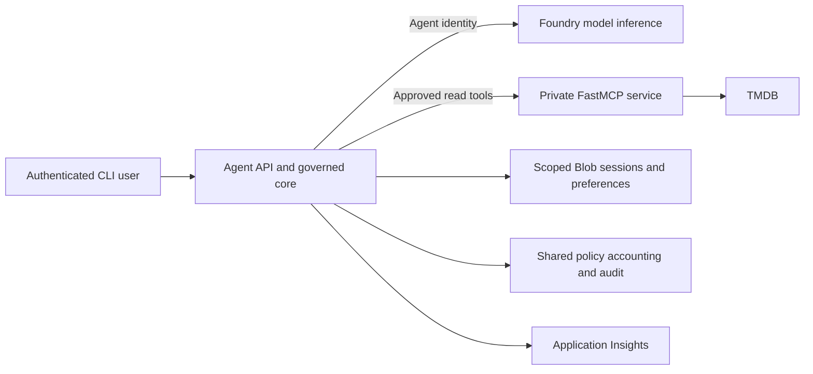

# az-maf-agent

A reference application for building governed AI agents on Azure with Microsoft Agent Framework. It brings together model inference, MCP tools, reviewed skills, user memory, identity, operational controls and evidence-backed validation in one evolving codebase.

The goal is to make the architecture understandable and its boundaries testable: models propose answers and actions, while application code decides what may run, whose data may be used and how much work is allowed. The repository is a teaching and architectural reference, with a working dev implementation and documented production acceptance gaps.

Movie assistance is the example domain. It provides a concrete way to explore useful agent behavior, source retrieval, personalization and adversarial requests without giving the agent a general-purpose shell or writable external system.

## What the application demonstrates

| Capability | Approach |
| --- | --- |
| Agent runtime | Python, Microsoft Agent Framework and an authenticated FastAPI service hosted in Azure Container Apps |
| Model inference | Approved Microsoft Foundry deployments, application-controlled model routing and shared usage budgets |
| Tools | A separate FastMCP service exposing bounded, read-only TMDB search and movie details |
| Skills | Reviewed Markdown artifacts with approved versions, SHA-256 integrity checks, capability restrictions and revocation |
| Conversation state | Bounded history and owner-scoped sessions, with a shared Blob-backed hosted adapter |
| User memory | Explicitly consented genre/language preferences, scoped storage, expiry, correction and deletion |
| Identity | Entra user authentication, Entra Agent ID for inference/MCP, and separate workload and operator identities |
| Governance | Shared accounting, policy checks, cancellation, capability disable, global stop and controlled recovery |
| Observability | Content-free agent/model/tool traces in Application Insights, plus protected dispatch audit |
| Delivery | A workspace monorepo, separate service images, reusable Bicep infrastructure and GitHub Actions |

These capabilities are introduced incrementally, but the application is one integrated system. The [implementation roadmap](docs/tasks/README.md) tracks the individual learning stages and their acceptance evidence.

## Architecture



The agent and MCP run as separate applications. Foundry supplies inference; the agent runtime remains in Container Apps. Caller identity, agent identity, infrastructure access and operator authority serve different purposes. Instructions, history, retrieved content and model output cannot grant permissions.

Start with the [architecture review package](docs/architecture-review/README.md) for integration diagrams, trust boundaries, design decisions, evidence and open review questions. Its [grounding assurance page](docs/architecture-review/12-grounding-assurance.md) distinguishes demonstrated source retrieval and action enforcement from broader answer-faithfulness claims.

## Try the offline example

Use Python 3.12 and [uv](https://docs.astral.sh/uv/):

```sh
uv sync --locked --all-packages
uv run --locked agent-chat
```

The default is a deterministic fake model and requires no Azure account or credentials. Send a couple of messages to see bounded conversation context, use `/reset` to clear it, and `/quit` to exit. The fake does not answer real questions or call external services.

For an approved hosted deployment:

```sh
uv run --locked agent-chat --api https://YOUR_APPROVED_AGENT_API
```

Hosted use requires the matching Entra client configuration and an authorized account. The CLI uses an encrypted, OS-user-scoped token cache and silently refreshes when authentication policy permits. Do not commit tokens or pass credentials as command-line arguments.

The hosted CLI also supports reviewed skills such as `--skill movie-research`, explicit movie reads with `--movies`, and preference commands such as `/memory`, `/remember preferred_genre comedy` and `/forget all`. Ordinary chat does not consent to saving a preference. See the [skills guide](docs/stages/stage-3/stage-3-skills.md), [memory guide](docs/stages/stage-4/stage-4-memory.md) and [TMDB integration guide](docs/tmdb-integration.md) for setup and behavior.

## Repository layout

| Path | Purpose |
| --- | --- |
| [apps/agent/](apps/agent/) | CLI, API, agent core, model adapters, memory and governance |
| [apps/movie-catalog-mcp/](apps/movie-catalog-mcp/) | Separately packaged FastMCP service and TMDB adapter |
| [config/](config/) | Validated configuration, policies and fixed evaluation inputs |
| [skills/](skills/) | Approved skill manifests and reviewed Markdown |
| [infra/](infra/README.md) | One Bicep entry point, resource modules, application patterns and environment parameters |
| [.github/workflows/](.github/workflows/) | CI, infrastructure validation and environment deployment |
| [scripts/](scripts/) | Operator utilities and bounded validation exercises |
| [docs/](docs/README.md) | Architecture, decisions, guides, roadmap and retained evidence |

Dependencies are locked in [uv.lock](uv.lock). The infrastructure layout follows Azure Developer CLI conventions through [azure.yaml](azure.yaml), with environment-specific settings kept separate from application code. See the [deployment guide](docs/github-actions-deployment.md) for dev automation and controlled stage/prod promotion.

## Validate changes

```sh
uv run --locked pytest -q
uv run --locked ruff check apps scripts
uv run --locked ruff format --check apps scripts
```

Browse [validation results by stage](docs/stages/README.md) for guides, reports and supporting evidence. Local fixtures and hosted tests establish different things. Use the [evidence register](docs/architecture-review/09-evidence-register.md) to find the tested release, environment, identities, outcomes and limitations. Live exercises must retain existing permissions and budgets; a model refusal or HTTP 200 alone is not proof of enforcement.

## Scope and operating principles

- The agent and MCP expose movie reads; they cannot add, edit or delete TMDB movies. This non-commercial example includes the required [TMDB attribution](docs/credits.md).
- Saved preferences require explicit consent. Working history, durable preferences, authoritative controls and audit are separate data concerns.
- Budgets and permission checks apply across model attempts and tools. Reset, retries and model selection cannot legitimately reset shared accounting or widen authority.
- Routine traces omit prompts, answers, memory values, tool payloads and credentials. Protected audit and telemetry have different roles.
- The recorded dev baseline is not blanket production approval. Final network enforcement, hosted distinct-user/replica exercises and operational rehearsals remain in the [review gap register](docs/architecture-review/10-review-gaps.md).

For the detailed contracts, see the [teaching specification](docs/secure-agent-teaching-spec.md). For implementation history and current progress, see the [change log](docs/change-log.md) and [roadmap](docs/tasks/README.md).
