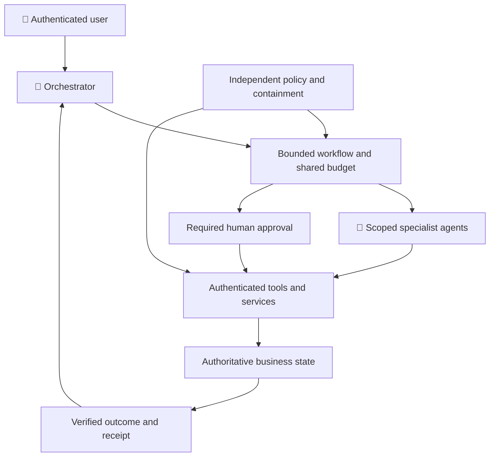
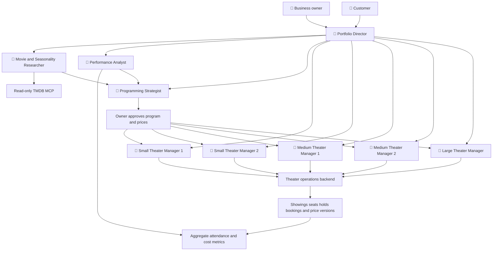
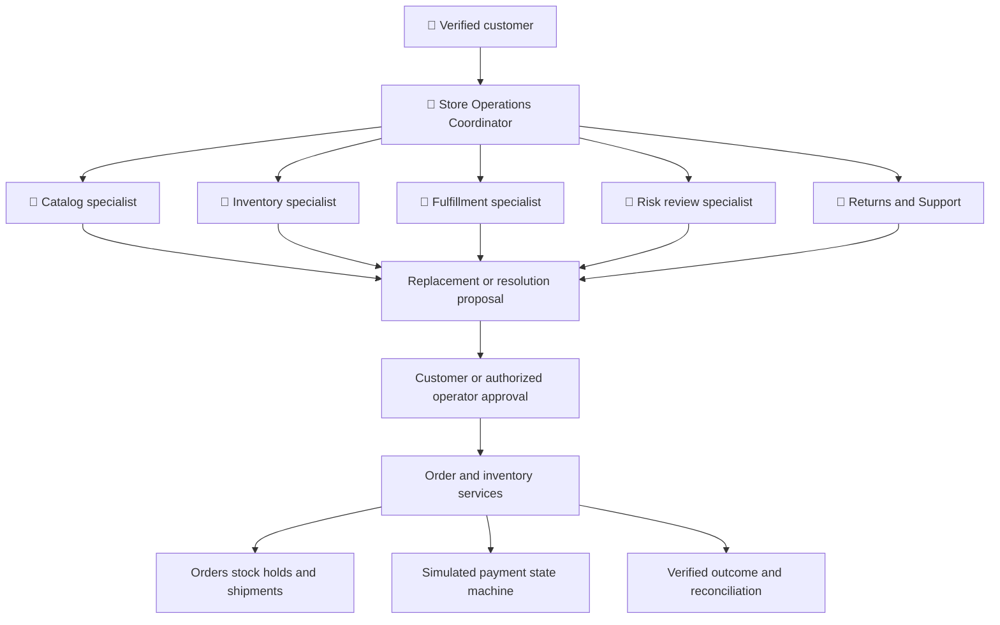
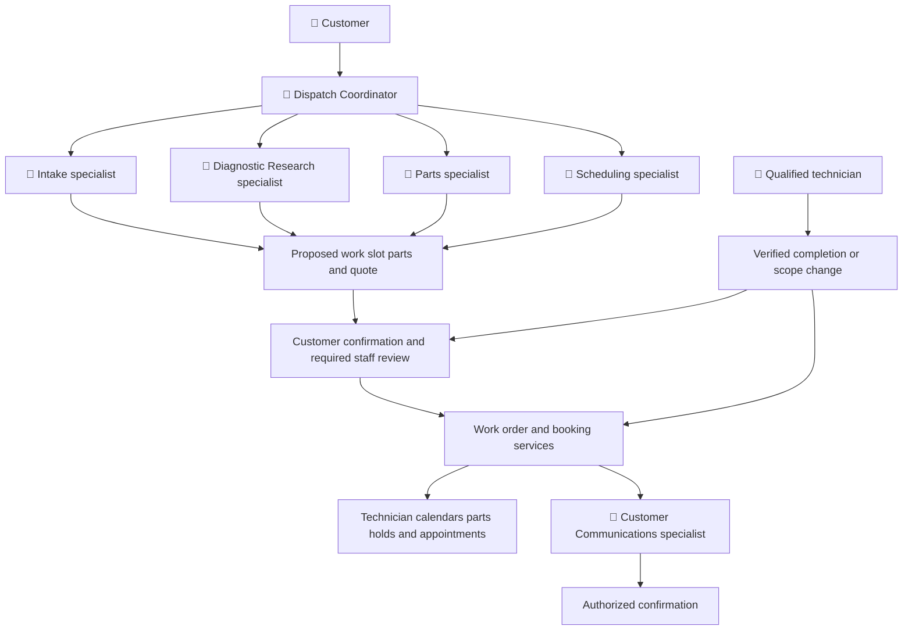
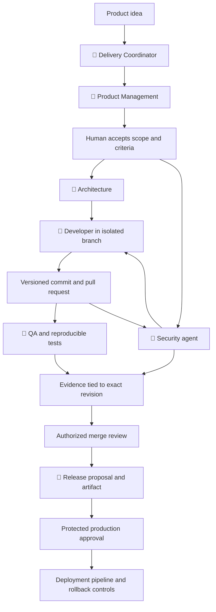
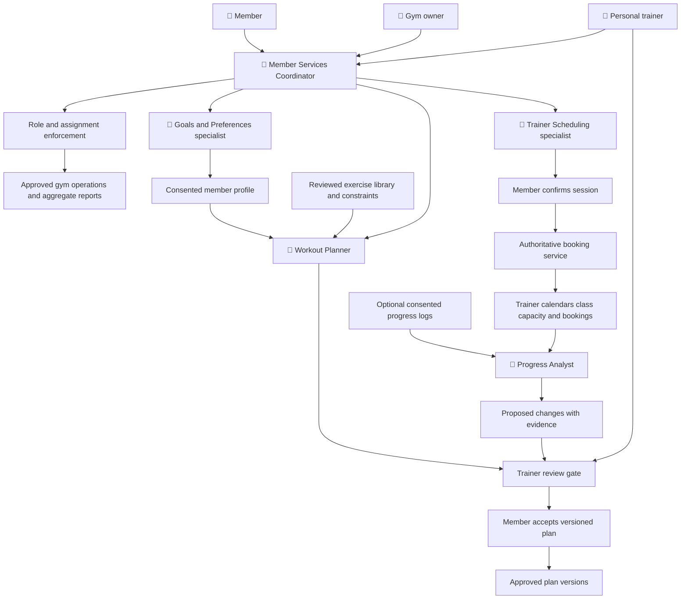
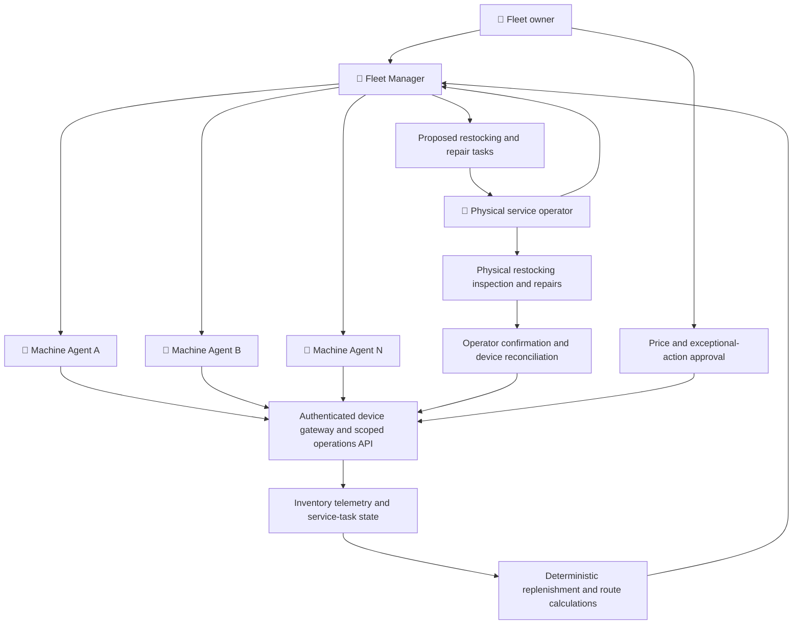

# Agent orchestration scenarios

Status: **design exploration**, 2026-10-20. These scenarios describe possible applications, not implemented capabilities or acceptance results. The movie-theater scenario has a [Stage 11 plan](stages/stage-11/README.md); the other scenarios are examples, not additional committed stages.

## When orchestration earns its cost

Start with one agent and a small set of scoped tools. Introduce specialist agents when independent responsibilities, permissions, evidence or long-running handoffs justify extra model calls, latency and operational complexity. A persona name alone does not establish an independent agent or a security boundary.

Use deterministic workflows for known sequences and calculations. Use an agent to interpret an ambiguous request, research evidence or propose alternatives. Multiple agents are useful when these activities need different authority or independent evaluation; they are unnecessary merely to call several APIs in order.

| Scenario | Business owner/orchestrator | Specialist responsibilities | Authoritative shared state | Human decision gates |
| --- | --- | --- | --- | --- |
| Five-theater business | Portfolio Director | Location management, movie research, performance analysis, programming | Screens, showings, seats, reservations, event calendar, published prices | Publish programs/prices, exceptional overrides |
| E-commerce operations | Store Operations Coordinator | Catalog, inventory, fulfillment, risk review, returns/support | Orders, stock reservations, shipments, refund status | Purchase/refund exceptions, policy changes, release of flagged orders |
| Field service | Dispatch Coordinator | Intake, diagnosis, scheduling, parts, customer updates | Work orders, technician calendars, parts holds, appointments | Exceptional dispatch, expensive parts, scope/quote changes |
| Software delivery | Delivery Coordinator | Product, architecture, development, QA, security, release | Approved requirements, commits, issues, test results, deployment records | Scope acceptance, merge, production deployment |
| Vending-machine fleet | Fleet Manager | One machine agent per vending machine | Inventory, telemetry, service tasks and verified physical counts | Operator confirms physical work; owner approves prices and exceptions |
| Gym and personal training | Member Services Coordinator | Member goals, workout planning, trainer scheduling, progress review | Consented member profile, approved plans, trainer calendars, session bookings | Trainer approval of plans, member consent, consequential booking changes |

## Common architecture and handoff contract

**Diagram legend:** 🤖 marks an agent persona or a group of agents; 👤 marks a human user. Unmarked nodes represent services, data stores, inputs or workflow/approval steps. Approval steps are distinct from the people authorized to approve them.

In the scenario diagrams, named specialist/coordinator nodes are agent personas. Owners, customers, members, technicians and qualified trainers are people; services, stores, approval gates and calculations are enforced system components. The rosters below enumerate every agent persona explicitly.

Every handoff carries a verified caller, tenant/user scope, parent run, permitted action/resource, deadline, budget allocation, idempotency key and evidence references. Bind an approval to the exact action, resource, version, amount and expiry; changed arguments require a new decision. Do not forward broad credentials or treat a peer's natural-language instructions as authority.

The orchestrator may request work only within the caller's rights. Specialist permissions remain narrow, and tools enforce scope independently. Keep shared root limits across children, bound concurrency and depth, propagate cancellation, and recheck policy before dispatch and commit. Checkpoints retain approved state, not secrets or private reasoning. Audit who requested, approved and committed an action without copying sensitive content.

Retries require idempotency and version checks. A workflow can span several services without one database transaction: record each committed step and define compensation, reconciliation or manual escalation. Never announce success until the authoritative service confirms it. A specialist's failure or quarantine must not silently redirect its authority to a broader agent.

## 1. Five-theater business

### Agent persona roster

| Agent persona | Instances | Responsibility |
| --- | --- | --- |
| Portfolio Director | 1 | Coordinates the owner request, bounded delegation and portfolio recommendations. |
| Small Theater Manager 1 | 1 | Manages approved operations for small location 1 only. |
| Small Theater Manager 2 | 1 | Manages approved operations for small location 2 only. |
| Medium Theater Manager 1 | 1 | Manages approved operations for medium location 1 only. |
| Medium Theater Manager 2 | 1 | Manages approved operations for medium location 2 only. |
| Large Theater Manager | 1 | Manages approved operations for the large location only. |
| Movie and Seasonality Researcher | 1 | Retrieves sourced movie facts and seasonal hypotheses. |
| Performance Analyst | 1 | Explains aggregate performance and deterministic pricing results. |
| Programming Strategist | 1 | Proposes evidence-backed schedules and prices for review. |

These are logical agent roles in this example, invoked only as needed. Human approvers and deterministic services are not additional agent personas.

**Request:** “Compare next month's programming across my five locations, account for Halloween demand, suggest ticket prices, and let me review changes before publication.”

The Portfolio Director coordinates five location-scoped Theater Managers, a Movie and Seasonality Researcher, a Performance Analyst and a Programming Strategist: nine logical agents, invoked only as needed. The [Stage 11 defaults](stages/stage-11/simulation-defaults.json) model two small, two medium and one large location: twenty screens and 3,520 seats in total.

1. Researcher retrieves approved movie facts; Analyst computes comparisons from aggregate synthetic attendance and cost data.
2. Strategist proposes showings and prices using deterministic capacity, calendar and pricing calculations. Seasonal effects remain explicit hypotheses with uncertainty.
3. Owner reviews the exact program/price changes; each Manager commits only to its location after a version check.
4. Customers can reserve tickets or private/group events through a stateful backend enforcing capacity, holds and calendar conflicts. Committed reservations preserve their quoted price.

**Boundaries:** TMDB remains a read-only source of movie facts, not live ticket inventory or evidence of local profitability. The planned operations backend is separate. Payments are disabled, all business records are synthetic, and live exhibition rights are outside this simulation.

**Proof to collect:** competing reservations cannot oversell; group bookings cannot overlap screenings; one manager cannot access another location's private records; expired approval cannot publish a price; missing costs prevent a profit claim; interrupted runs reconcile committed bookings.

**Simpler alternative:** one location with a basic lookup/reservation flow can use one agent and deterministic tools. Portfolio analysis and independently scoped managers provide the stronger reason for orchestration.

## 2. E-commerce operations

### Agent persona roster

| Agent persona | Instances | Responsibility |
| --- | --- | --- |
| Store Operations Coordinator | 1 | Coordinates customer resolution and bounded handoffs. |
| Catalog specialist | 1 | Finds suitable products using verified catalog facts. |
| Inventory specialist | 1 | Checks stock and requests scoped expiring holds. |
| Fulfillment specialist | 1 | Compares shipping and fulfillment options. |
| Risk Review specialist | 1 | Explains service-produced risk signals and escalates exceptions; cannot clear risk controls. |
| Returns and Support specialist | 1 | Verifies order scope and proposes policy-compliant resolutions. |

These are logical agent roles in this example, invoked only as needed. Human approvers and deterministic services are not additional agent personas.

**Request:** “Find an available replacement for this delayed item, explain the options, and arrange the customer's chosen resolution.”

The Store Operations Coordinator delegates catalog matching, inventory checks, fulfillment planning, risk review and returns/support. Risk calculations and payment authorization belong to enforced services; an LLM recommendation is not a fraud clearance or a payment authorization.

1. Support verifies customer/order ownership and identifies the requested resolution.
2. Catalog and Inventory specialists propose suitable items and obtain expiring stock holds from the authoritative inventory service.
3. Fulfillment checks delivery options; the customer or authorized operator approves the exact substitute, cost and address change where required.
4. Order services commit the change idempotently. The workflow releases unused holds and reports actual order/shipment state.

**Payment simulation:** use fake payment references and a stub with authorize, capture, void and refund states. Do not collect card data. A later real integration would need a separately approved payment-provider design, bounded customer authorization and merchant controls; a conversational “yes” or agent identity alone is insufficient. Keep payment credentials out of model context.

**Boundaries:** separate customer support from refund authority; enforce refund ceilings and previously refunded totals; verify addresses and order scope without exposing another customer's records. Product descriptions, seller messages and returned documents are untrusted data.

**Proof to collect:** concurrent orders cannot consume the same last unit; retry cannot duplicate capture/refund; price changes invalidate approval; malicious catalog text cannot request customer data; partial fulfillment failure releases or reconciles stock and payment holds.

**Simpler alternative:** order-status questions need one agent and a read-only order tool. Introduce orchestration for cross-service resolution with distinct inventory, fulfillment and financial authority.

## 3. Field service and appointments

### Agent persona roster

| Agent persona | Instances | Responsibility |
| --- | --- | --- |
| Dispatch Coordinator | 1 | Coordinates work orders and escalates changes. |
| Intake specialist | 1 | Collects the minimum approved service details. |
| Diagnostic Research specialist | 1 | Finds relevant manual evidence and advisory diagnostic options. |
| Scheduling specialist | 1 | Proposes qualified technicians and feasible appointment slots. |
| Parts specialist | 1 | Checks required parts and requests inventory holds. |
| Customer Communications specialist | 1 | Prepares authorized updates from verified work-order state. |

These are logical agent roles in this example, invoked only as needed. Human approvers and deterministic services are not additional agent personas.

**Request:** “Schedule a repair, reserve the likely part, and notify me if the technician or repair scope changes.”

The Dispatch Coordinator works with Intake, Diagnostic Research, Scheduling, Parts and Customer Communications specialists. Diagnostic suggestions remain advisory; technicians make on-site decisions, and safety-sensitive work needs qualified review.

1. Intake collects the minimum approved contact, location and equipment information.
2. Diagnostic Research suggests likely work and uncertainty from approved manuals; Parts checks inventory.
3. Scheduling proposes slots using deterministic availability, qualifications, travel buffers and working-hour rules.
4. The customer approves an appointment/quote as applicable; backend services reserve the slot and parts, then Communications sends an authorized confirmation.
5. Changed scope or price returns for review. Completion and unused parts are reconciled against the work order.

**Boundaries:** technician agents see assigned work only; customer contact data is purpose-scoped; the agent cannot invent qualifications or override safety constraints. Notifications require authorized recipients and approved channels. No autonomous control of physical equipment is included.

**Proof to collect:** two customers cannot book the same technician interval; expired parts holds are released; cancellation cannot leave an orphan appointment; rescheduling preserves approval requirements; untrusted manuals cannot cause data exfiltration; outages produce a pending status rather than false confirmation.

**Simpler alternative:** a single scheduling API and a short intake conversation usually need one agent. Orchestration becomes useful when parts, dispatch, diagnosis and customer approval evolve independently.

## 4. Software development lifecycle

### Agent persona roster

| Agent persona | Instances | Responsibility |
| --- | --- | --- |
| Delivery Coordinator | 1 | Coordinates dependencies and evidence without self-approving release. |
| Product Management | 1 | Drafts requirements, priorities and testable acceptance criteria. |
| Architecture | 1 | Proposes interfaces, design options and architecture decisions. |
| Developer | 1 | Implements bounded changes in an isolated workspace. |
| QA | 1 | Evaluates accepted requirements against the actual revision. |
| Security | 1 | Reviews threats and verifies remediation against the actual revision. |
| Release | 1 | Prepares artifact, rollout and rollback proposals. |

These are logical agent roles in this example, invoked only as needed. Human approvers and deterministic services are not additional agent personas.

**Request:** “Turn this product idea into a reviewed implementation and release proposal, with evidence that it meets the accepted requirements.”

| Role | Deliverable | Authority boundary |
| --- | --- | --- |
| Delivery Coordinator | Dependency plan, status, evidence links | Cannot approve its own scope or release |
| Product Management | User problem, acceptance criteria, priorities | Human product owner accepts scope |
| Architecture | Options, interfaces, threat model, decisions | Proposes design; review resolves material tradeoffs |
| Developer | Scoped changes and pull request | Writes in an isolated branch/workspace; no production credentials |
| QA | Requirement-linked tests and reproducible results | Reports failures independently; cannot waive acceptance |
| Security | Findings, adversarial cases, remediation evidence | Cannot silently suppress findings or self-authorize exceptions |
| Release | Artifact provenance, rollout/rollback proposal | Protected pipeline and human approval control production |

1. Product clarifies the request; a human accepts testable scope and constraints.
2. Architecture and Security identify interfaces, data boundaries and risks before implementation.
3. Developer makes bounded changes. QA and Security inspect the actual commit/artifact, returning findings with evidence.
4. Developer addresses findings; reviewers rerun affected checks against the new revision. A changed commit invalidates stale approval/evidence where applicable.
5. Authorized reviewers approve merging. Release proposes a versioned artifact and rollout; production deployment follows environment protections and explicit authorization.

**Boundaries:** repository files, issues, dependency output and pull-request comments are untrusted inputs. A comment cannot grant tool permissions. Use branch protection, scoped tokens, isolated execution, restricted egress and independent checks. Never give an agent unrestricted shell or secrets merely because its persona is “Developer.” An automated reviewer is not equivalent to independent human approval.

**Proof to collect:** tests map to accepted requirements; concurrent edits cannot overwrite another agent's work; malicious repository instructions cannot expose credentials; generated code cannot change approval policy to approve itself; findings and approvals reference the correct revision; failed rollout triggers the reviewed recovery path.

**Simpler alternative:** a small bug fix often needs one coding agent plus conventional CI and human review. Multiple agents are justified by independent evidence or parallel bounded work, not a ceremonial handoff for every role.

## 5. Gym and personal training

### Agent persona roster

| Agent persona | Instances | Responsibility |
| --- | --- | --- |
| Member Services Coordinator | 1 | Coordinates member requests and consent-aware handoffs. |
| Goals and Preferences specialist | 1 | Collects approved goals and preferences with explicit consent. |
| Workout Planner | 1 | Proposes routines within reviewed constraints for trainer review. |
| Trainer Scheduling specialist | 1 | Proposes available trainers and classes through scoped tools. |
| Progress Analyst | 1 | Summarizes approved logs and proposes evidence-backed changes. |

These are logical agent roles in this example, invoked only as needed. Human approvers and deterministic services are not additional agent personas.

**Request:** “Help me build a consistent training routine, book a trainer twice a week, and review my progress before changing the plan.”

The Member Services Coordinator works with a Goals and Preferences specialist, Workout Planner, Trainer Scheduling specialist and Progress Analyst. A qualified human trainer reviews proposed exercise plans and material changes. These roles support fitness coaching and gym operations; they do not diagnose conditions, prescribe treatment or replace clinical advice.

1. Goals and Preferences collects explicitly consented goals, experience, availability and equipment preferences. Start with synthetic profiles; avoid collecting medical records or detailed health information unless a separately reviewed purpose and policy require them.
2. Workout Planner proposes a routine from a reviewed exercise library and trainer-defined constraints, including duration, equipment and progression limits. Member-reported limitations trigger trainer review rather than an agent inventing a rehabilitation plan.
3. Scheduling proposes available trainers or classes using authoritative calendars, qualifications, capacity and cancellation rules. The member confirms the session; the backend commits the booking and returns its actual status.
4. Progress Analyst summarizes approved attendance, member feedback and training logs, distinguishing observed measurements from estimates. Missed sessions or wearable data alone do not justify automatic increases in intensity.
5. A trainer reviews proposed material plan changes and the member accepts them. Version the plan so the member can see what changed, why and who approved it.

**Human users and access:** the **member**, **gym owner** and **personal trainer** are separate authenticated users, not agent personas. Members manage their own goals, consent and bookings. Owners manage gym operations, staff assignments, capacity and approved aggregate reports; ownership does not grant blanket access to sensitive member notes. Personal trainers review plans and progress only for assigned, authorized members. The same person can hold multiple explicitly granted roles, but each action is checked against its purpose, assignment and resource scope. Owner requests and trainer requests enter through the coordinator with their own verified identity; member consent cannot be granted by an agent or assumed from an owner's request.

**Shared state:** member-owned preferences and consent, trainer-approved plan versions, session/class capacity, holds, bookings, attendance and optional progress logs. Separate operational booking access from sensitive notes. A trainer sees only assigned members; gym-wide reports use approved aggregates. Let members inspect, correct or delete eligible stored preferences and revoke optional data access under the documented retention policy.

**Boundaries:** no payments, supplement sales, clinical nutrition plans or autonomous control of exercise equipment in the initial simulation. Do not infer diagnoses or expose body measurements, injury disclosures or other sensitive notes in notifications, group leaderboards or model telemetry. Wearable integrations are optional and purpose-scoped; device text and imported plans remain untrusted input. Concerning symptoms stop the proposed workout flow and trigger the reviewed human escalation path rather than further coaching.

**Proof to collect:** an owner cannot use operational access to retrieve sensitive member notes; a trainer cannot impersonate a member or grant their consent; concurrent bookings cannot overfill a class or double-book a trainer; a member cannot read another member's plan; an unassigned trainer cannot retrieve private logs; expired consent blocks optional data retrieval; revoked wearable access cannot be reused; malicious exercise descriptions cannot change permissions; a plan change cannot bypass trainer review; cancellation releases capacity without duplicate notifications.

**Simpler alternative:** class availability and basic booking usually need one agent with scoped tools. Orchestration becomes useful when trainer review, personalized planning, scheduling and longitudinal progress have distinct responsibilities and access rules. Compare it against a single-agent baseline before adding every specialist.

## 6. Vending-machine fleet

**Request:** “Manage my vending-machine fleet, identify machines that need stock or repairs, and give the operator a practical service route.”

### Agent persona roster

| Agent persona | Instances | Responsibility |
| --- | --- | --- |
| Fleet Manager | 1 | Coordinates machine reports, prioritizes replenishment/maintenance and proposes operator work; cannot declare physical work complete. |
| Machine Agent | N, one per vending machine | Interprets that machine's approved telemetry, reports stock/faults and requests service within its own machine scope. |

This is **1 + N logical agents**. Machine Agents A, B and N in the diagram illustrate the repeated role, not a fixed three-machine fleet. A machine agent is a software identity associated with a device; it does not require an LLM running inside the machine. Select cloud or edge hosting after evaluating connectivity, cost and device capability. Physical operators and owners are human users, not agents. One person may hold both roles through explicitly assigned permissions.

1. Each Machine Agent receives authenticated, timestamped telemetry for its own device: stock estimates, sales counters, faults and approved condition readings. Missing or stale readings remain unknown rather than invented.
2. Fleet Manager compares reports using deterministic reorder thresholds, warehouse availability, service priorities and route constraints. It proposes a bounded route with stock quantities and required skills.
3. The assigned operator accepts tasks, physically inspects/restocks/repairs the machines and records counts, consumed parts and exceptions. An agent can request this work but cannot perform it through conversation.
4. Backend services reconcile operator confirmations with device observations and inventory movements using versions and idempotency keys. Disagreements stay flagged for review; the agent cannot clear a fault simply by saying it is fixed.
5. Fleet owner reviews proposed price changes or exceptional actions before publication. The system reports confirmed updates separately from pending or unreachable devices.

**Human users and access:** the fleet owner manages business policy, assignments and approved fleet reports. A physical service operator sees assigned machines, work orders and required stock only. An operator does not automatically gain price-policy, credential-management or fleet-wide access. Record who accepted and completed each physical task, without treating an agent-generated receipt as proof of a visit.

**Shared state:** device registry and identities, per-machine product slots and stock versions, warehouse stock, telemetry freshness, service-task assignments, restocking movements, approved prices and reconciliation status. The operations service is authoritative; model memory is not the stock ledger. A Machine Agent cannot impersonate another device or read another machine's credentials. Revoking one machine's identity must not disable the entire fleet or permit another agent to inherit its authority.

**Boundaries:** begin with simulated devices, synthetic sales and no payment processing or real actuator access. Device messages and maintenance notes are untrusted data. Neither an agent nor a remote user may bypass local hardware interlocks, open a cabinet, change firmware, dispense products or override safety controls through this example. A future real-device integration needs separately reviewed command permissions, signed/versioned commands, local safety enforcement and offline recovery. Do not collect customer payment credentials; revenue reports consume approved aggregate counters only.

**Proof to collect:** forged telemetry fails authentication; a machine cannot submit another machine's report; stale readings cannot justify a confirmed stock claim; duplicate restocking reports cannot create stock twice; concurrent tasks cannot reserve the same warehouse units; an unassigned operator cannot close a task; a disconnected device remains pending; malicious telemetry cannot change price policy; quarantining one Machine Agent blocks its new operations while other machines continue safely.

**Simpler alternative:** fixed reorder thresholds and scheduled route generation often need conventional IoT rules and an optimizer, not one LLM per device. Evaluate the machine-agent design when individual devices need bounded interpretation, exception handling or independent containment. Use event-driven invocations and deterministic telemetry processing rather than paying for a continuous model conversation per machine.

## Evaluation and adoption

For each scenario, compare against one agent with tools and a deterministic workflow using the same fixtures, permissions and total budget. Measure task correctness, unauthorized effects, grounded claims, completion time, model/tool cost, recovery from faults and human intervention. More agents are worthwhile only if the benefit outweighs coordination failures and cost.

Start with synthetic records and stub external effects. Test malicious peer responses, prompt injection, cross-user access, stale approvals, duplicate requests, races, cancellation, unavailable dependencies and identity disable with cached tokens. Record limitations as well as successful outcomes; separate planning examples from deployed acceptance evidence.

Related plans: [Stage 8 operational readiness](stages/stage-8/README.md), [Stage 9 sensitive-data controls](stages/stage-9/README.md), [Stage 10 framework adoption](stages/stage-10/README.md), and [Stage 11 theater simulation](stages/stage-11/README.md).
