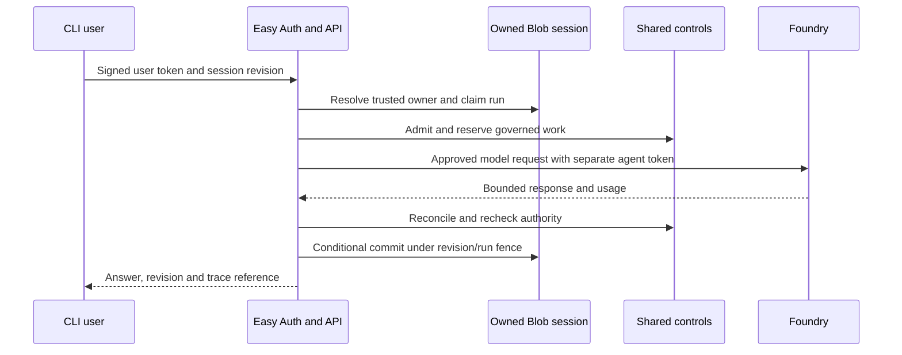

# 01 — Agent, API and session architecture

**Review scope:** Stage 1 with Stage 5 shared-session extensions. **Status:** implemented in dev; local isolation/fencing and hosted authorized chat are evidenced. Actual cross-replica session/race acceptance remains open.

## Purpose and selected design

An authenticated CLI calls a Python HTTPS API in Azure Container Apps. The same agent core also supports a deterministic local fake model for teaching/tests. The live agent does not accept an unauthenticated local identity. Microsoft Agent Framework supplies the agent/session abstraction; the app owns its bounded inference/tool loop and state commitments.

## Trust and data boundaries

User identity derives from verified Entra claims, not JSON fields, model output or caller-supplied identity headers. Easy Auth and application checks are complementary. Incoming user credentials are not forwarded to inference or MCP. The API checks approved callers and tenant/user ownership for session and run operations.

Short-term chat is distinct from durable preferences. Hosted sessions use the private `agent-sessions` Blob container with conditional updates, a 30-minute idle timeout and four-hour maximum lifetime. Old Stage 1 restart-loss reports describe the previous RAM deployment; they are not the selected hosted storage design. Local fake mode may remain process-local.

History is bounded to 32,768 bytes/8,000 conservative tokens by selected configuration. Input is at most 16,384 bytes, application context 16,000 tokens, output 2,000 tokens, run reservation 24,000 tokens. Trimming/history cannot supply identity, permissions, approval or authoritative counters. Provider-managed conversation IDs are not used to move context between models.

## Failure and concurrency behavior

A session revision and active run fence control commit. Stale revisions, duplicate/concurrent writes and reset races deny in local tests. Failed/cancelled/late operations cannot append history after a newer reset. Reset removes working history; it does not replenish tool, spend or aggregate security counters, or delete consented preferences. Expired documents require bounded cleanup within 24 hours. No version history or dev soft-delete backup is selected.

Provider outcomes can remain unknown after cancellation; the app preserves reservations and uses bounded reconciliation. A response arriving after a fence changes does not justify a late commit. Blob ETags coordinate one document; they are not a transaction across all policy/session objects.

## Evidence and review questions

**E01, E02, E05, E09** in the evidence register establish the release, auth/session fixtures, selected storage and actual dev chats. Hosted wrong-audience/spoofed-token cases are recorded in Stage 4; genuine expired-token rejection is recorded in Stage 5. Stage 6 adds a same-user mini → GPT-5 → mini history check.

Do not declare multi-replica correctness from source tests or an observed replica count. Complete **R02/R03** for distinct hosted users, duplicate/concurrent requests, replica/revision changes and reset races. Revalidate absence of alternate public API bypass in the final topology (**R01**). These gates remain prerequisites for the corresponding production claims.

## Source and evidence references

- [Stage 1 tasks and remaining acceptance](https://github.com/gardlt/az-maf-agent/blob/d65b5fc480a6eb8e593ac9fe0fd020dffd644b50/docs/tasks/stage-1-chat.md)
- [Shared session implementation](https://github.com/gardlt/az-maf-agent/blob/d65b5fc480a6eb8e593ac9fe0fd020dffd644b50/apps/agent/src/az_maf_agent/shared_sessions.py)
- [API and identity checks](https://github.com/gardlt/az-maf-agent/blob/d65b5fc480a6eb8e593ac9fe0fd020dffd644b50/apps/agent/src/az_maf_agent/api.py)
- [Shared session local tests](https://github.com/gardlt/az-maf-agent/blob/d65b5fc480a6eb8e593ac9fe0fd020dffd644b50/apps/agent/tests/test_shared_sessions.py)
- [Expired-token hosted evidence](https://github.com/gardlt/az-maf-agent/blob/d65b5fc480a6eb8e593ac9fe0fd020dffd644b50/docs/validation/stage-5-evidence/expired-token.json)

Related: [review index](README.md), [evidence register](09-evidence-register.md), [open review gates](10-review-gaps.md).
