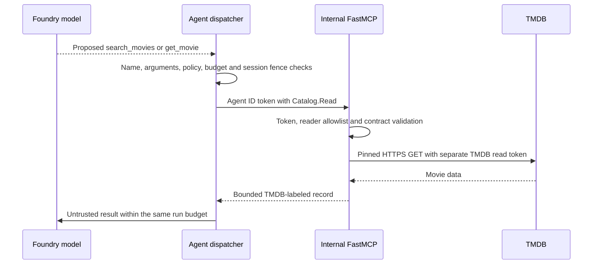

# 02 — Agent to movie MCP architecture

**Review scope:** Stage 2, with current Agent ID and Stage 6 validation. **Status:** read-only integration implemented and evidenced in dev. Historical test-network evidence does not close current production egress gates.

## Purpose and selected design

A separately packaged **FastMCP** service retrieves movie facts from TMDB for a non-commercial teaching project. It replaces the synthetic catalog entirely. Neither the current agent nor the current MCP exposes a movie create, edit or delete operation. Historical synthetic admin PUT demonstrations are not current functionality.

## Interface, authority and grounding

The only tool names are `search_movies(query, limit)` and `get_movie(catalog_id)`. Limits are bounded; movie IDs use `tmdb_<id>`. Extra fields, generic URLs, arbitrary HTTP methods, unknown tools and caller-supplied identity arguments are rejected. The model proposes a call; application code validates and authorizes it before any network dispatch. The model-selected loop permits at most two sequential catalog read attempts per run, in addition to shared/session bounds.

The MCP uses internal ingress and independently verifies the expected token signature, issuer, audience, tenant, exact agent identity and `Catalog.Read` role. It does not trust network location alone. User tokens are not forwarded. The TMDB API Read Access Token exists only at the MCP service boundary; it is not model input or an agent credential.

The TMDB adapter pins `https://api.themoviedb.org` and GET search/detail paths, disables redirects, excludes adult results, uses a five-second upstream timeout and a 128 KiB response cap. The normalized result carries `source: TMDB`, `catalog_version: tmdb-v1` and at most 8 KiB of bounded output. Attribution and credits are part of the teaching distribution. `tmdb-v1` identifies the adapter contract, **not** an immutable upstream database snapshot. Movie text remains untrusted and cannot grant permission.

## Failure behavior and evidence

Malformed IDs/arguments fail before calls; missing movies return bounded not-found data. Rate limits, provider failures and oversized/malformed output do not return upstream credential-bearing bodies. A proposed movie write fails even if the user claims administrator permission or human approval. No write tool is enabled by that claim.

**E03:** 50/50 direct dev queries succeeded across ten sessions; an earlier one-session attempt stopped at its read budget. **E08:** the separate 50-session behavior exercise used one identity, not 50 distinct accounts; initial overload/admission failures are retained. **E09:** the routed release returned 403 for invented create/update tools and 422 for hidden write fields; protected dispatch audit had zero forbidden capabilities and sampled movie fields stayed unchanged. These demonstrate bounded enforcement, not universal injection resistance or TMDB-wide immutability.

## Decisions and open review questions

A separate service/package permits independent image/deployment and a narrow outbound credential boundary. HTTP MCP supports hosted separation; local stdio remains useful for tests. A generic web/HTTP tool or writable catalog would require a new threat model and privileges, not a wider prompt.

Complete **R01** for final-topology egress and internal ingress/bypass tests. Source-level URL/GET pinning is not a network firewall. **R04** covers stronger answer-to-source faithfulness evidence: a successful tool call alone does not prove that every generated movie claim came from its result.

## Source and evidence references

- [Current movie contract and client](https://github.com/gardlt/az-maf-agent/blob/d65b5fc480a6eb8e593ac9fe0fd020dffd644b50/apps/agent/src/az_maf_agent/movie_mcp.py)
- [Bounded model/tool loop](https://github.com/gardlt/az-maf-agent/blob/d65b5fc480a6eb8e593ac9fe0fd020dffd644b50/apps/agent/src/az_maf_agent/model_tools.py)
- [TMDB GET adapter](https://github.com/gardlt/az-maf-agent/blob/d65b5fc480a6eb8e593ac9fe0fd020dffd644b50/apps/movie-catalog-mcp/src/movie_catalog_mcp/tmdb.py)
- [FastMCP service](https://github.com/gardlt/az-maf-agent/blob/d65b5fc480a6eb8e593ac9fe0fd020dffd644b50/apps/movie-catalog-mcp/src/movie_catalog_mcp/server.py)
- [Direct 50-query results](https://github.com/gardlt/az-maf-agent/blob/d65b5fc480a6eb8e593ac9fe0fd020dffd644b50/docs/mcp-50-query-results.md)
- [Historical Stage 2 validation, separately labeled](https://github.com/gardlt/az-maf-agent/blob/d65b5fc480a6eb8e593ac9fe0fd020dffd644b50/docs/stage-2-validation.md)
- [Current routed security verification](https://github.com/gardlt/az-maf-agent/blob/d65b5fc480a6eb8e593ac9fe0fd020dffd644b50/docs/validation/stage-6-security.json)
- [TMDB attribution](https://github.com/gardlt/az-maf-agent/blob/d65b5fc480a6eb8e593ac9fe0fd020dffd644b50/docs/credits.md)

Related: [review index](README.md), [evidence register](09-evidence-register.md), [open review gates](10-review-gaps.md).
