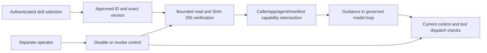

# 03 — Agent to approved Markdown skills

**Review scope:** Stage 3. **Status:** reviewed skills implemented and hosted dev behavior recorded; memory-layer boundary coverage was subsequently added in Stage 4.

## Purpose and flow

Skills provide reviewed task guidance without granting new authority. `movie-research@1.0.0` guides movie comparison; `movie-night@1.0.0` guides a shortlist. They use the same two bounded movie-read tools and cannot install tools, run code, load more skills or access durable preferences.

## Artifact and permission boundary

The Git-reviewed index pins ID, version, owner, purpose, capability set and exact Markdown SHA-256. Content ships in the reviewed image. The loader resolves an approved ID before filesystem access, rejects unsupported fields/dependencies, refuses escaping filenames/final symlinks, bounds the file to 8 KiB and consumes the same verified bytes. Trusted operator-owned ancestor directories remain an assumption. Digest matching is integrity against the reviewed index, not third-party signing or proof that the text is safe.

Caller, application, agent and manifest permissions intersect; they do not union. Markdown, synopsis text or an apparently helpful instruction cannot create a write, shell, filesystem, memory or arbitrary-network capability. A skill identifier can affect the approved Stage 6 model route only after normal approval/integrity checks; that model selection does not widen its tools.

Skills do not inherit durable records or earlier personalized history. An ordinary user message is not consent to save memory. This keeps a skill from turning saved data into instructions or accidentally seeing data outside its intended teaching purpose.

## Control, failure and lifecycle

The reviewed bundle is operator-owned. The small teaching control record uses the dev resource group's `maf-skill-control` tag; the runtime reads it with workload identity and cannot change it. Shared Stage 5 policy gates apply in addition. Missing, invalid, stale/rolled-back or unreachable control denies dependent work. Load, model attempts, tool dispatch and final commit recheck applicable controls. Accepted external work cannot be undone, but revoked guidance cannot authorize a later effect or stale commit.

Changed content receives a new approved version/digest and reviewed release. Runtime skill publication or marketplace installation is not exposed. A disabled version may be restored through separate operator control; a revoked version cannot be revived by selecting old content. The tag store's small size and cross-operator update limits are documented; it is not a general production registry/control plane.

## Evidence and remaining review

**E04** covers actual hosted success for both approved skills, pinned hashes, unknown-skill denial, movie-write denial, disable without deployment and integrity/revocation fixtures. **E05** adds real memory-layer scope/consent coverage; local results are not distinct-user hosted acceptance. The current full regression is 215 tests, rather than treating the earlier 81-test milestone as the current count.

Review **R02/R03/R05** before broader claims about distinct users, replicas, coordinated multi-operator revocation, and incident/rollback operation. Consider a larger registry only if artifact scale, signing or release requirements justify its additional controls.

## Source and evidence references

- [Approved skill index](https://github.com/gardlt/az-maf-agent/blob/d65b5fc480a6eb8e593ac9fe0fd020dffd644b50/skills/approved.json)
- [Loader and capability checks](https://github.com/gardlt/az-maf-agent/blob/d65b5fc480a6eb8e593ac9fe0fd020dffd644b50/apps/agent/src/az_maf_agent/skills.py)
- [Skill validation](https://github.com/gardlt/az-maf-agent/blob/d65b5fc480a6eb8e593ac9fe0fd020dffd644b50/docs/stage-3-validation.md)
- [Detailed skill operator guide](https://github.com/gardlt/az-maf-agent/blob/d65b5fc480a6eb8e593ac9fe0fd020dffd644b50/docs/stage-3-skills.md)
- [Memory boundary validation](https://github.com/gardlt/az-maf-agent/blob/d65b5fc480a6eb8e593ac9fe0fd020dffd644b50/docs/stage-4-validation.md)

Related: [review index](README.md), [evidence register](09-evidence-register.md), [open review gates](10-review-gaps.md).
