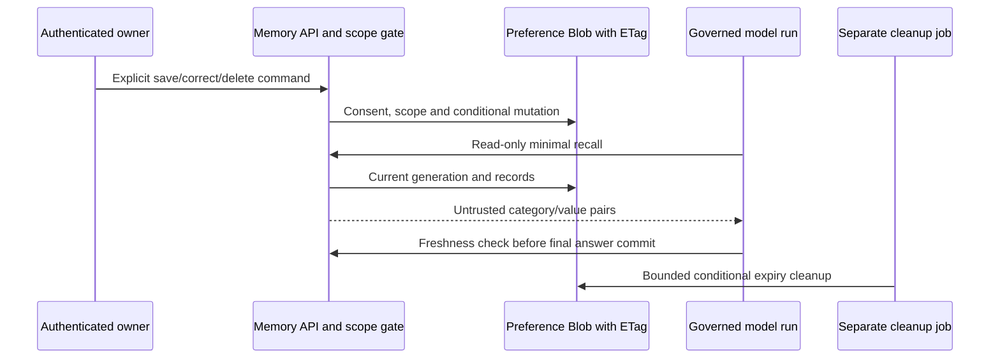

# 04 — Agent to governed memory

**Review scope:** Stage 4. **Status:** completed for the selected dev teaching preference policy; production backup/restore and broader isolation gates are not implied.

## Purpose and selected storage

The app stores a small structured preference document per trusted tenant/user/purpose in private Azure Blob Storage. The user selected explicit consent, same-user use across sessions, 30-day expiry and no dev backups/version history. Blob was chosen because exact genre/language fields need conditional updates and deletion, not semantic search. AI Search/vector storage would add derived copies, relevance behavior and deletion obligations without improving this bounded case.

## Data and consent contract

Only `preferred_genre` and `preferred_language` from fixed enums are allowed. Free text, transcripts, arbitrary keys, embeddings and credentials are not memory categories. Blob names derive from a hash of trusted identity/purpose; the caller/model cannot supply another user's namespace. Hashing identifiers is pseudonymization, not authorization by itself; owned-session and access checks still apply.

Explicit owner operations grant consent to save/correct. Ordinary chat and model output do not. Records carry lifecycle/provenance/version metadata. Recall supplies only category/value pairs labeled as untrusted data, not permission. Reviewed skills receive no durable memory or earlier personalized history. Short-term conversation storage is separate and has a much shorter TTL.

## Consistency, deletion and failure

Create uses `If-None-Match`; correction/deletion use exact ETags plus generation/revision checks. Conflicts fail without blind retries. Unknown write outcomes require inspection. Forget retains an empty advanced generation fence, preventing stale recreation. Read-time expiry excludes values immediately; the hourly job conditionally removes expired bodies within the selected 24-hour target. It has bounded page/time limits; outages or excessive namespace size require operator action rather than an unlimited cleanup claim.

Deletion/correction/expiry invalidate personalized working history by generation. A final fresh check rejects a result if memory changed during inference. Reset clears chat, not durable preferences. Already displayed answers cannot be withdrawn from a terminal. No versioning/soft-delete backups are selected for dev; introducing backups later requires deletion/restore fencing review.

Storage uses managed identity, private containers, HTTPS/encryption and no Shared Key/anonymous access. Runtime and cleanup identities have distinct responsibilities. Bounded asynchronous workers retain slots for uncertain operations; cancellation cannot promise that an already dispatched PUT never committed. Required authorization/audit precedes effects.

## Evidence and open review

**E05** records hosted consent denial, body-identity rejection, same-user cross-session persistence after a real restart, correction, recall, deletion, stale recreation denial and an actual expired-fixture cleanup job. Fixtures cover cross-user/tenant scope; the hosted test uses one approved user. All seeded preferences were removed after the exercise.

Review **R02** for two real hosted identities, **R03** for replica races, **R05** for broader recovery/rotation and **R06** for cleanup alert operation. The current overdue-cleanup portal alert has no external notification recipient; enabled alerting does not establish an acknowledged on-call response. No production RPO/RTO or backup-restore guarantee is approved.

## Source and evidence references

- [Preference policy and operator guide](https://github.com/gardlt/az-maf-agent/blob/d65b5fc480a6eb8e593ac9fe0fd020dffd644b50/docs/stage-4-memory.md)
- [Hosted/local memory evidence](https://github.com/gardlt/az-maf-agent/blob/d65b5fc480a6eb8e593ac9fe0fd020dffd644b50/docs/stage-4-validation.md)
- [Preference storage implementation](https://github.com/gardlt/az-maf-agent/blob/d65b5fc480a6eb8e593ac9fe0fd020dffd644b50/apps/agent/src/az_maf_agent/blob_memory.py)
- [Memory-layer tests](https://github.com/gardlt/az-maf-agent/blob/d65b5fc480a6eb8e593ac9fe0fd020dffd644b50/apps/agent/tests/test_memory.py)
- [Blob consistency tests](https://github.com/gardlt/az-maf-agent/blob/d65b5fc480a6eb8e593ac9fe0fd020dffd644b50/apps/agent/tests/test_blob_memory.py)

Related: [review index](README.md), [evidence register](09-evidence-register.md), [open review gates](10-review-gaps.md).
