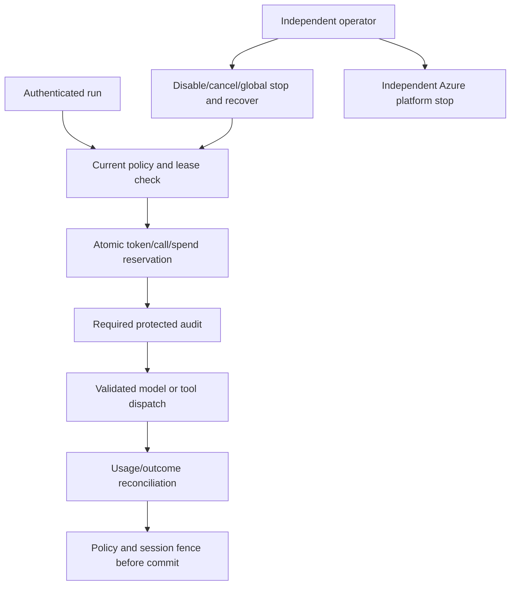

# 05 — Shared guardrails, audit and operator recovery

**Review scope:** Stage 5. **Status:** substantial dev implementation/evidence; **Stage 5 remains incomplete** against its broader production release criteria.

## Control architecture

Policy, shared accounting, short-term sessions and audit use separate private Blob containers. ETag transactions coordinate each shared state document. The runtime can read policy, update allowed state/session objects and append protected audit. A separate operator writes policy and performs recovery; the agent/model has no policy-writing API or deployment/stop authority.

## Selected dev contract

| Control | Selected bound |
| --- | --- |
| Policy | Before dispatch; active runs polled every 2 seconds |
| Containment objective | 10 seconds, subject to the recorded exercise scope |
| Lease | 30 seconds |
| Model run | 8 model attempts/turn bound; 2 retries; 120-second run / 30-second call deadline |
| Token reservations | 16,000 context / 2,000 output / 24,000 per run |
| Spend | $0.25/run and $5/day per scoped caller |
| Parallelism | 2 runs per user, 10 globally |
| Protected audit | 30 days, Unlocked policy |

The application reserves conservatively; failed/ambiguous attempts are not refunded. Actual usage and unknown usage remain distinct from reservations. Cancellation is not invoice cancellation. Reset, retry, routing and new replicas cannot legitimately reset authoritative accounting.

## Shutdown, consequential actions and audit

The control layers are deny one call, cancel one run, disable a named capability without app deployment, and global stop across shared admission/dispatch. Epoch floors, leases, watchdog checks and session fences prevent stale work from committing. A separate Azure operator can stop every known active revision when workers ignore application cancellation. Policy recovery is explicit and preserves accounting, disabled capabilities and reconciled unknown outcomes.

The classroom-credit fixture is a separate bounded simulated action, not a movie PUT or real transfer. Policy permission and exact-argument, short-lived, single-use human approval are both required. Receipt/approval consumption commit atomically. A claimed approval in chat grants nothing; forbidden tools remain forbidden even with approval.

Audit envelopes are hash-verified and required before effects; trace delivery is supplemental. Runtime cannot read/delete protected audit. The 30-day retention is **Unlocked**: privileged administrators can change the policy. Hashes and retention are useful integrity controls, not an immutable cryptographic transparency service or protection from all administrators.

Policy publication and state updates span separate objects. Partial publication fails closed through the policy floor; there is no cross-Blob distributed transaction. Outage/reconciliation paths must preserve uncertain reservations rather than deleting state to regain availability. Growing a single accounting document requires capacity/partition review, not an unlimited scale claim.

## Evidence and remaining acceptance

**E06:** stopped ingress persisted across an actual restart; a synthetic isolated two-revision worker was verified stopped with zero replicas in 2.299 seconds and runtime stop authority returned 403. This does not prove every live provider terminates within that time. **E07/E09:** real shipped audit/GenAI spans and protected dispatch checks were inspected; the latest routed batch has zero forbidden dispatches with all tested runs reconciled.

Open **R01/R02/R03/R05/R06** cover final network denial, distinct-user/replica tests, remaining hosted approval/outage/kill-propagation cases, qualitative effect review, rotation, rollback and incident rehearsal. The full ten-second objective is not universally passed by the synthetic worker result. Production review must close or explicitly disposition those gates; a checked milestone is not Stage 5 completion.

## Source and evidence references

- [Stage 5 selected contract and evidence chronology](https://github.com/gardlt/az-maf-agent/blob/d65b5fc480a6eb8e593ac9fe0fd020dffd644b50/docs/stage-5-production-guardrails.md)
- [Outstanding Stage 5 release checklist](https://github.com/gardlt/az-maf-agent/blob/d65b5fc480a6eb8e593ac9fe0fd020dffd644b50/docs/tasks/stage-5-production-guardrails.md)
- [Operator runbook](https://github.com/gardlt/az-maf-agent/blob/d65b5fc480a6eb8e593ac9fe0fd020dffd644b50/docs/stage-5-operator-runbook.md)
- [Transactional run controls](https://github.com/gardlt/az-maf-agent/blob/d65b5fc480a6eb8e593ac9fe0fd020dffd644b50/apps/agent/src/az_maf_agent/guardrails.py)
- [Protected Blob adapter](https://github.com/gardlt/az-maf-agent/blob/d65b5fc480a6eb8e593ac9fe0fd020dffd644b50/apps/agent/src/az_maf_agent/guardrail_blob.py)
- [Manual platform stop evidence](https://github.com/gardlt/az-maf-agent/blob/d65b5fc480a6eb8e593ac9fe0fd020dffd644b50/docs/validation/stage-5-evidence/manual-stop.json)

Related: [review index](README.md), [evidence register](09-evidence-register.md), [open review gates](10-review-gaps.md).

## Stage 7 containment extension

[Stage 7](14-agent-containment.md) adds per-Agent-ID quarantine and directory disable beyond Stage 5 capability/global-stop controls. The local injectable gate cancels active work and preserves accounting; it is not enabled in the hosted app. The live identity drill proved directory disable/restoration while cached tokens and workload-identity Blob access remained usable. No inference is drawn that the existing 10-second runtime stop objective revokes all service credentials. Independent hosted controller, resource gates and explicit recovery remain required.
