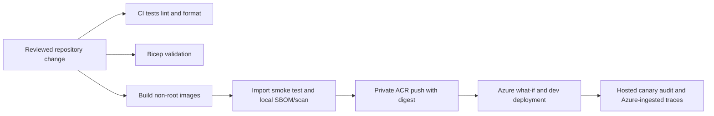

# 08 — Delivery, observability and operational architecture

**Review scope:** monorepo, Azure infrastructure, supply chain, release controls and operational evidence. **Status:** reproducible dev release verified; production promotion and final networking/incident gates remain open.

## Packaging and delivery

The monorepo separates `apps/agent` and `apps/movie-catalog-mcp`, with independently built images and service-targeted deployment support. `infra/main.bicep`, reusable `infra/modules/` and environment `.bicepparam` files describe Azure resources. Directory provisioning and privileged role bootstrap are separate from ordinary deployment. Reproducibility also depends on external Entra objects, TMDB credentials, model availability and approved environment settings; Bicep alone is not a complete directory/secret bootstrap.

Main changes matching deployment paths automatically target **dev**. Stage/prod are manually selected promotion targets. The workflow supports a selected agent, MCP or all-service run; normal qualifying main pushes currently deploy the full environment. Separate service packages do not mean all merges automatically rebuild only the changed service. Required-reviewer/branch-protection settings are deployment requirements to verify, not proven merely because YAML refers to environment names.

## Supply chain and secrets

Images run non-root, pin the reviewed base by digest and install locked dependencies. Build/import smoke tests precede scanning and push. Local Syft/Grype gate unresolved **High and Critical**, including unfixed findings; scanner failure fails release. Docker Scout/external layer upload remains skipped. Both current images passed with zero High/Critical, while 14 Medium, 1 Low and 1 Negligible finding remain per image at the recorded scanner database state. A passing scan is time-specific, not absence of all vulnerabilities.

TMDB and application authentication secrets are supplied through approved environment secrets/settings, not source. Local secret files are excluded from Git/build contexts. A historical source-archive exposure concern led to TMDB rotation; document that incident and exclusion proof rather than concealing it. Full selected Key Vault/secret rotation and recovery rehearsal remain open gates. Do not assume secrets are Key Vault-backed without implementation evidence.

## Runtime and monitoring

The last recorded ready agent is revision 31 and MCP revision 29, with exact OCI digests in **E01**. App traffic remains in the original Container Apps environment. A parallel VNet/Basic Firewall foundation exists, but cutover is not complete; ACR remains Basic by user decision. The reviewed Premium prerequisite was declined, so a compatible image-delivery/network solution must be selected before the final topology gate.

Explicit GenAI tracing correlates agent/model/tool operations and observed token usage in Application Insights. User confirmation establishes Agents (Preview) visibility; Azure-ingested trace queries independently establish correlation/redaction. Protected Blob audit remains the required dispatch record. Trace exporter flush, dashboard presence or sampling does not prove audit persistence. Full exporter outage/backpressure and failure/cancellation hosted coverage remains open.

An hourly cleanup job and portal alert support expiry operation; no external alert recipients are configured. Alert ownership, escalation and acknowledgement need acceptance. Preserve policy epochs and unknown usage through recovery. Schema-2 state cannot be rolled back to a schema-1-only reader. No production RTO/RPO, disaster recovery target or capacity SLO is established by the finite canaries.

The model comparison measures inference only. Its $5/day per-caller application bound does not cap subscription-wide spend, Container Apps compute, storage, logging or the separately deployed firewall/network foundation. Assess those infrastructure costs and idle resources independently using the retained migration review and current billing/configuration evidence.

## Evidence and open decisions

**E01/E06/E07/E08/E09/E10** bind releases, stop drills, ingested traces, load behavior, evaluation and scanning. The 50-session exercise used one identity: initial burst yielded 2 successes, 27 busy responses and 21 overloads; final paced journeys yielded 47 successes, 2 tool-budget stops and 1 provider rejection. It is evidence of bounded behavior, not a 50-user production capacity result.

Review **R01/R03/R05/R06/R07/R08/R09** for networking, scaling, recovery/rotation, on-call behavior, production approvals, effective cost/model settings and lower-severity vulnerability disposition. Refresh measurements after topology or identity changes.

## Source and evidence references

- [Deployment workflows and promotion guidance](https://github.com/gardlt/az-maf-agent/blob/d65b5fc480a6eb8e593ac9fe0fd020dffd644b50/docs/github-actions-deployment.md)
- [Dev environment inventory](https://github.com/gardlt/az-maf-agent/blob/d65b5fc480a6eb8e593ac9fe0fd020dffd644b50/docs/dev-environment-variables.md)
- [Recorded release revisions and digests](https://github.com/gardlt/az-maf-agent/blob/d65b5fc480a6eb8e593ac9fe0fd020dffd644b50/docs/validation/stage-6-release.json)
- [Release scan evidence](https://github.com/gardlt/az-maf-agent/blob/d65b5fc480a6eb8e593ac9fe0fd020dffd644b50/docs/validation/stage-6-image-scans.json)
- [Scan gate implementation](https://github.com/gardlt/az-maf-agent/blob/d65b5fc480a6eb8e593ac9fe0fd020dffd644b50/scripts/scan_release_image.sh)
- [Open network migration and registry decision](https://github.com/gardlt/az-maf-agent/blob/d65b5fc480a6eb8e593ac9fe0fd020dffd644b50/docs/stage-5-network-migration-review.md)
- [Agents Preview and remaining telemetry gates](https://github.com/gardlt/az-maf-agent/blob/d65b5fc480a6eb8e593ac9fe0fd020dffd644b50/docs/azure-monitor-agents-view.md)
- [50-session behavior and preserved failures](https://github.com/gardlt/az-maf-agent/blob/d65b5fc480a6eb8e593ac9fe0fd020dffd644b50/docs/validation/movie-agent-50-users.md)

Related: [review index](README.md), [evidence register](09-evidence-register.md), [open review gates](10-review-gaps.md).
