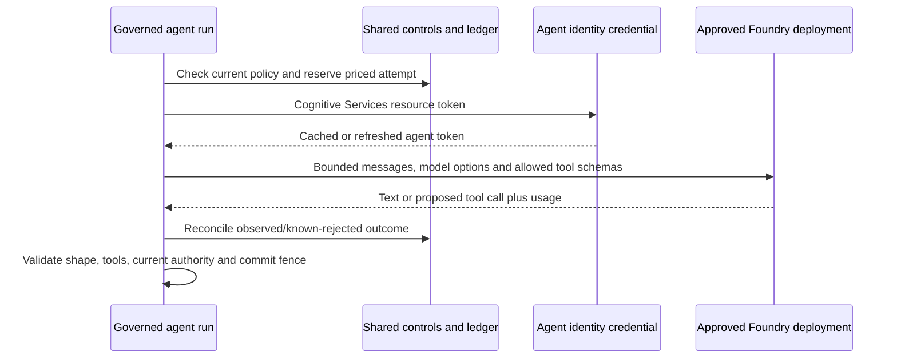

# 13 — Agent to Foundry inference

**Review scope:** the model-provider integration used by chat, tools and Stage 6 routing. **Status:** actual dev inference and Entra agent-token use are evidenced. Foundry provides model inference; the agent runtime remains in Container Apps.

## Runtime and interface boundary

The configured resource is `aif-homelab-rv6t99la`. The app calls its HTTPS Azure OpenAI Chat Completions deployment endpoint with a configured API version. It does not invoke a Foundry-hosted agent or use a provider-owned conversation as the authoritative session. The existing GPT-5 deployment and the approved GPT-5 mini deployment are selected through server-owned configuration.

The custom transport preserves a reviewable trust boundary. A text-only Agent Framework client forbids tool output in its path. The movie loop advertises only the two approved read schemas, validates every proposed call in application code and handles tools outside the model provider. A provider tool proposal is not an authenticated downstream MCP request.

## Identity and data sent to the provider

The Agent ID adapter acquires a Cognitive Services audience token through the approved federation/blueprint path and caches it with early refresh. The inference account grant is the selected **Foundry User** role. There is no fallback to an all-purpose operator credential, TMDB credential or incoming user's token. Actual selected token claims and successful inference are recorded separately from directory provisioning.

Messages may include the user's request, bounded user/assistant history, reviewed guidance, minimal consented category/value preferences when allowed, and validated movie tool output. The latter two remain untrusted data, not permission. No TMDB token, user bearer token, raw credential, arbitrary private file or unrestricted memory document belongs in model context.

The request uses bounded output and `store: false`, with application-managed history. That flag is a request setting; it is **not** evidence of every provider logging, abuse-monitoring, caching, retention or residency policy. The selected deployment SKU is GlobalStandard. A resource location alone must not be used as the review's complete data-processing/residency evidence. Record the verified service/configuration terms required by the organization's data policy under **R10**.

## Bounds, retry and failure behavior

The transport pins the configured origin/deployment/API version, disables redirects and bounds response consumption. Application limits are stricter than the model's advertised context window. Shared admission, pricing, audit, cancellation and fences apply before and after attempts. Usage is accepted only within the reserved output/context constraints; provider model identifiers are validated before trace export.

Known terminal provider rejections produce a metadata-only failure classification and confirmed rejection receipt where supported. Rate limits/transient errors have at most two configured retries, and every attempt is reserved. A timeout/network loss can leave an unknown outcome. Such a run retains conservative cost and reconciliation requirements; it is not automatically retried with a stronger model or refunded. Neither cancellation nor a model switch guarantees provider billing stops.

## Evidence and review boundaries

**E07** proves actual agent-token use/caching and authorized inference/MCP operation. **E09** proves current provider model versions and observed usage on the routed release, with source/configuration/image provenance. The fixed evaluation and route-history canaries demonstrate useful bounded operation, not universal factual grounding or comprehensive service availability.

Review **R04/R08/R10** for broader faithfulness, effective prices/quotas/version lifecycle and provider data handling. A change to API version, model, resource, reasoning level, tool semantics or context contract needs compatibility/evaluation review; do not assume provider interchangeability from a common API shape.

## Source and evidence references

- [Approved model configuration](https://github.com/gardlt/az-maf-agent/blob/d65b5fc480a6eb8e593ac9fe0fd020dffd644b50/config/foundry-stage1.json)
- [Guarded model transport and usage validation](https://github.com/gardlt/az-maf-agent/blob/d65b5fc480a6eb8e593ac9fe0fd020dffd644b50/apps/agent/src/az_maf_agent/model.py)
- [Application-owned tool loop](https://github.com/gardlt/az-maf-agent/blob/d65b5fc480a6eb8e593ac9fe0fd020dffd644b50/apps/agent/src/az_maf_agent/model_tools.py)
- [Agent token exchange/caching](https://github.com/gardlt/az-maf-agent/blob/d65b5fc480a6eb8e593ac9fe0fd020dffd644b50/apps/agent/src/az_maf_agent/agent_identity.py)
- [Actual downstream token-use evidence](https://github.com/gardlt/az-maf-agent/blob/d65b5fc480a6eb8e593ac9fe0fd020dffd644b50/docs/validation/stage-5-agent-id-observability.md)
- [Actual routed model versions and usage](https://github.com/gardlt/az-maf-agent/blob/d65b5fc480a6eb8e593ac9fe0fd020dffd644b50/docs/validation/stage-6-traces.json)

Related: [review index](README.md), [evidence register](09-evidence-register.md), [open review gates](10-review-gaps.md).
