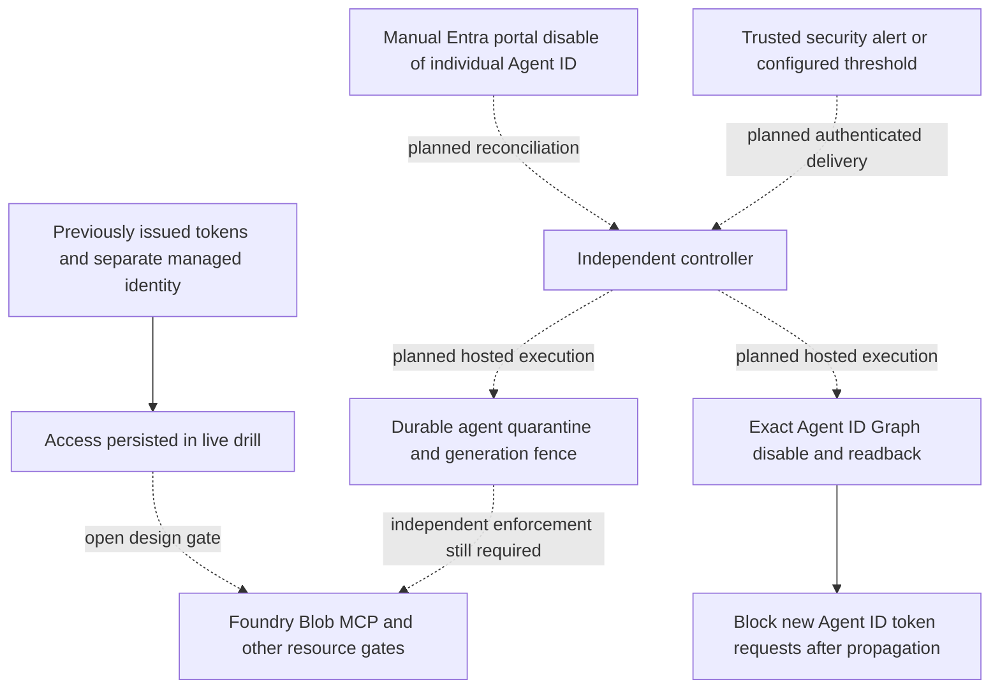

# 14 — Individual-agent containment and identity disable

**Review scope:** Stage 7. **Status:** local foundation implemented and tested; one explicitly authorized live identity disable-and-restore drill completed. **Automatic hosted containment and all-resource denial are not accepted.**

This page supplements the earlier review snapshot with 2026-10-20 evidence. It does not replace earlier release records or establish fresh inventory of the whole subscription.

## Design and trust boundaries

Each independently containable logical agent requires its own Entra Agent ID. The blueprint and federated workload managed identity are different objects and may be shared. Containing one agent must not disable a shared blueprint, stop unrelated agents or silently revoke shared credentials.

Dashed edges are planned integration, not deployed controls. Local implementations exist for durable development quarantine, detection windows/deduplication, bounded retry state, a disable-only Graph adapter and an injected runtime admission/dispatch gate. SQLite under one developer account is not a hosted isolation boundary. The model/runtime has no exposed containment mutation endpoint; production controller identity, storage authorization, alert attribution and watchdog authority still need design and hosted proof.

The local [controller contract](../stages/stage-7/controller-contract.md) now joins
authenticated-principal binding, configured rule selection, quarantine-first ordering,
exact identity disable and duplicate-incident reconciliation. Authentication transport,
shared hosted persistence and service-specific denial remain unimplemented.

The manual control is Entra admin center → Entra ID → Agents → Agent identities → select the verified individual agent → Disable. Portal disable and automated Graph disable must eventually feed the same independent quarantine/reconciliation process. A portal click alone is not full application/resource containment.

## Local and live evidence

[Local evidence](../stages/stage-7/validation/evidence/local-test-summary.json) records **235 passing tests**, including **20 containment cases**. They cover per-agent isolation, threshold/deduplication behavior, persistence, concurrent requests, active-run cancellation, accounting preservation, retries, wrong identity/type/blueprint binding, inconsistent projections and stale worker outcomes. These are fixture results; no live second-agent or external resource-denial claim follows from them.

The [live drill](../stages/stage-7/validation/live-disable-drill-2026-10-20.md) targeted only dev Agent ID `94a137c6-e4fc-481c-b45d-f2a03d868ba4` on agent revision `ca-maf-agent-dev-eus2-01--0000033`. Explicit authorization included restoration. Graph returned disabled readback; both Foundry and MCP token requests eventually failed with AADSTS7000112. Foundry token requests initially still succeeded, showing why propagation must be measured rather than assumed instantaneous.

During disabled state, cached Foundry token model-list GET returned 200, cached MCP credentials initialized/listed two tools, and Blob container metadata HEAD with a separate workload-identity token returned 200. This is a **negative all-resource containment result**, not a failed identity-disable action. No provider inference was invoked during disable. The samples do not prove the exact propagation deadline, external exfiltrated-token behavior or every Blob operation.

Explicit restoration returned 204 with enabled readback; fresh token requests for both audiences succeeded afterward. The private in-container token file was deleted and the timed restoration guard disarmed. Ordinary chat recovery was attempted but returned 429 `shared_daily_budget`; it is not a passed chat test. Budgets and reservations were not reset to obtain a green result.

## Implementation finding

Live Graph default projection omitted `appId` and `@odata.type` from the typed Agent ID response. The original strict adapter failed closed. The local fix explicitly reads the base principal identity/type and typed blueprint binding, checks their consistency, and writes only `accountEnabled=false`. Verified readback remains mandatory. Regression tests cover that actual response shape and inconsistent projections. The tested correction is local; it is not a new controller deployment.

## Open decisions and acceptance gates

- Inventory every effective credential, inherited grant and Azure resource, including retained legacy/workload grants and alternate paths.
- Independently deny cached/exfiltrated tokens, native managed identity, SAS/keys and open sessions per service. An allowlisted endpoint or a stopped worker alone does not establish denial elsewhere.
- Deploy a least-privileged controller outside agent authority; authenticate/bind alerts; persist quarantine before acknowledgment; implement failure escalation and outage leases.
- Prove live A/B isolation, multi-replica/queue races, independent service gates, repeated timing drills and explicit human-authorized recovery. Re-enabling directory auth must not replay old work or reset accounting.
- Keep Stage 5 network/isolation/operations gates separate. No completion claim is warranted until all required resource paths and failure cases are measured.

See [Stage 7 tasks](../tasks/stage-7-agent-containment.md), [QA/evidence register](../stages/stage-7/validation/README.md), [identity architecture](07-identity-and-access.md) and [open review gates](10-review-gaps.md).
