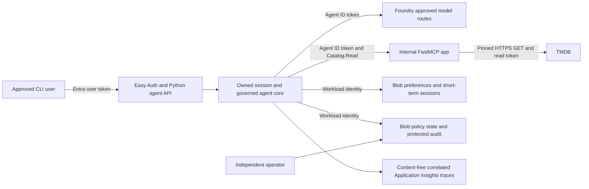

# Azure agent application — architecture review package

Prepared: **2026-10-20**. Repository: `gardlt/az-maf-agent`. Audience: cloud architecture, software architecture, application security and operations reviewers. Status: **draft review submission; no architecture board approval recorded**.

This is a local review package organized as separate pages. Nothing has been published to Confluence. The implementation snapshot is commit `d65b5fc480a6eb8e593ac9fe0fd020dffd644b50`; its deployed application source is `681e8407a4097a243156d3d184d14cf7f67e37d4`. Descriptions of cloud state refer to recorded validation, not a fresh Azure inventory performed for this document. A dated [Stage 7 addendum](14-agent-containment.md) records the later local containment implementation and limited live identity drill; the original snapshot remains the baseline for earlier claims.

## Review position

The project is an evidence-backed **dev teaching baseline**, with authenticated chat, read-only movie tools, reviewed skills, consented preferences, shared controls, Entra Agent ID, correlated traces and model routing. It is suitable to present for architectural review. **Production readiness and universal answer grounding are not established.** Stage 5 still has release gates, and the quality checks are narrower than full answer-to-source faithfulness evaluation.

The original stage documents include retired resources and historical experiments. These pages distinguish the selected current design from those historical results. Evidence from one topology, identity or model release is not silently promoted to all environments.

## Page hierarchy and suggested review order

| Page | Review question | Stage |
| --- | --- | --- |
| [01 — Agent, API and sessions](01-agent-api-sessions.md) | Who may invoke the app, and how is conversation state isolated? | 1, extended by 5 |
| [02 — Agent to movie MCP](02-agent-to-mcp.md) | How does the agent retrieve trusted-source movie data without write authority? | 2 |
| [03 — Agent to reviewed skills](03-agent-to-skills.md) | How are instructions approved, verified and revoked? | 3 |
| [04 — Agent to memory](04-agent-to-memory.md) | What is saved, with whose consent, and how is it deleted? | 4 |
| [05 — Guardrails and recovery](05-guardrails-and-recovery.md) | How are budgets, dispatch, shutdown and recovery enforced? | 5 |
| [13 — Agent to Foundry inference](13-agent-to-foundry.md) | How is model inference authenticated, bounded and reconciled? | Provider integration |
| [06 — Model routing](06-model-routing.md) | How are cheaper/stronger models selected and measured? | 6 |
| [14 — Individual-agent containment](14-agent-containment.md) | Does disabling one identity stop both new and cached resource access? | 7 |
| [07 — Identity and permissions](07-identity-and-access.md) | Which identity accesses each downstream resource? | Cross-cutting |
| [08 — Delivery and operations](08-delivery-and-operations.md) | How is a release reproduced, scanned, deployed and observed? | Cross-cutting |
| [09 — Evidence register](09-evidence-register.md) | Which retained artifacts substantiate each claim? | All |
| [10 — Review gaps and decisions](10-review-gaps.md) | What must be resolved before broader release? | All |
| [11 — Architecture decisions](11-architecture-decisions.md) | Why were these patterns selected over alternatives? | All |
| [12 — Grounding assurance](12-grounding-assurance.md) | What can we prove about source use, accuracy and authorization? | All |
| [15 — MCP, skills, and direct API access](15-mcp-skills-api-access.md) | Should TMDB calls stay behind MCP, move into fixed agent tools, or become executable skill capabilities? | Open issue |

Each integration page provides its purpose, flow, trust/data boundaries, failure behavior, evidence and open review questions. Identity and operations pages describe shared controls rather than requiring reviewers to infer them from separate stage reports.

## System context

The agent and MCP are separately packaged applications in one monorepo and deployed as separate Container Apps. The agent runs in Container Apps; Foundry supplies inference. It is not a Foundry-hosted agent service. Models, Markdown, history and tool output never become authorization sources. The separately deployed firewall foundation is **not** shown as an enforced traffic path: app migration and final network tests remain open.

## Evidence vocabulary

- **Hosted verified:** observed against the named release/environment with retained results.
- **Local verified:** deterministic fixture/source tests; not proof of deployed networking or multiple identities.
- **Historical:** valid for its recorded release/topology only.
- **Configured/design:** present in configuration or implementation; broader operation still needs acceptance.
- **Open:** required evidence or a review decision is missing.

HTTP 200 is not proof of a permitted backend effect. A refusal is not proof of enforcement. Exporter flush is not proof of telemetry ingestion. Token minting is not proof of downstream token use. A configured boundary is not proof of a network deny. These distinctions are carried through the evidence register.

## Review administration

The application owner, cloud architect, security reviewer, data/privacy reviewer and operations reviewer are **to be assigned** by the project. Their approval, risk acceptance and remediation dates are not implied by this package. Record decisions against [open gates](10-review-gaps.md) with evidence and a named accountable person.

Before a formal review, refresh release/image inventory, RBAC, final network topology, policy epoch, effective model prices and test evidence. Include the exact environment and observation date. Re-run bounded live tests only under approved accounts/budgets, not merely to populate screenshots.

The repository remains the local source of truth. If publication is later requested, preserve this hierarchy and immutable evidence links. Verify diagram rendering and page links in the destination; Mermaid support in another documentation platform is not assumed.
