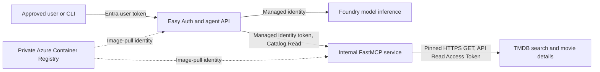

# Stage 2 architecture — agent and TMDB movie MCP

**Deployment status:** The dedicated agent and FastMCP Container Apps and their environment were retired on 2026-10-18. This diagram records the tested architecture, not a currently running deployment.

The user selected TMDB as the sole movie source for this non-commercial teaching project. The agent and separate FastMCP service ran as two Container Apps in the `cae-az-maf-stage1` environment in East US 2. The MCP had internal ingress only. The older synthetic catalog and admin PUT implementation have been removed from repository code. [Stage 2 validation](stage-2-validation.md) separates TMDB results from the historical synthetic experiment.

## Trust boundaries

| Boundary | Enforcement | Access |
| --- | --- | --- |
| User → agent | Container Apps Easy Auth verifies the Entra user token; the API checks the approved user and session | Chat and opt-in movie read routes; no movie write route |
| Agent → Foundry | Agent system-assigned managed identity and Foundry roles | Configured model deployment for inference |
| Agent → MCP | Agent system-assigned managed identity obtains a token for catalog API `ddf8d97d-9b4a-4ce8-9fd2-a7293ad909cb`; MCP verifies signature, issuer, audience, tenant, exact agent object ID `71edeec2-8419-4709-9120-35b3f8f86067`, and list-valued `Catalog.Read` role | `search_movies` and `get_movie` only |
| MCP → TMDB | Container App secret supplies the API Read Access Token to the MCP process | Pinned movie search and details GET endpoints only; no TMDB user session or write capability |
| Container Apps → registry | Separate user-assigned pull identity with `AcrPull` | Digest-pinned image pulls |

The user token is never forwarded to the MCP or TMDB. The TMDB token is not sent to the agent, Foundry model, CLI response, or Git. The old `Catalog.Admin` role definition remains on the catalog API registration without an assignment; its temporary probe, assignment, and managed identity were deleted.

## Read path and limits

For explicit and model-selected movie reads, the agent validates the tool name and exact arguments before contacting MCP. Its client pins the internal HTTPS `/mcp` endpoint, rejects redirects and unexpected advertised tool schemas, and validates the returned `tmdb-v1` object within an 8 KiB bound. Model-selected reads allow at most two sequential attempts and charge model attempts to the existing budget ledger. Only the final user/assistant text pair enters session history.

The MCP checks its own reader allowlist and revocation state, then uses the TMDB adapter. The adapter accepts only bounded queries or `tmdb_<id>` IDs; it calls `GET /3/search/movie` or `GET /3/movie/{id}` at `https://api.themoviedb.org`, disables redirects, applies a five-second timeout and 128 KiB upstream-response cap, excludes adult results, and returns source-labeled bounded records. It handles missing movies and rate limits without returning upstream bodies or credentials. There is no generic URL, filesystem, arbitrary API path, admin PUT, or write MCP tool.

The agent API is still a single-replica teaching deployment. Its Stage 1 shared-session and budget limitations remain documented in the [teaching specification](secure-agent-teaching-spec.md); Stage 2 movie data is read-only and is not stored as mutable catalog state.

## Deployment and remaining boundary

The MCP revision `ca-az-maf-movie-mcp--0000002` is healthy on image digest `sha256:8f0b79e3bf22f576acd4b3bfcf5be17d40bcbdb55522081905bd6c55a802890f`. Its TMDB secret was rotated on 2026-10-18. Agent revision `ca-az-maf-stage1--0000013` is healthy on digest `sha256:dd7c5bfd78a079538050cad3da83466cce82427869da1e9a5d0d90d1b47180f5`, rebuilt with the secret file excluded from the image-build archive. Hosted signed-in search, details, model-selected read, denial, Stage 1 regression, and the authenticated `/about` Credits page checks passed as recorded in [validation](stage-2-validation.md).

The existing environment has no VNet or workload profiles. A separate [network-test foundation and duplicate apps](stage-2-network-design.md) demonstrated an NSG deny to one test-owned public IP while the approved TMDB and Foundry paths remained healthy. This closes the Stage 2 **controlled test-destination** acceptance check; it does not turn the existing Stage 1 environment into a production outbound allowlist. Any future separately built hosted user interface must also display the [TMDB credits](credits.md).

## Implementation map

- Agent API and session rules: `apps/agent/src/az_maf_agent/api.py` and `core.py`.
- Agent MCP contract, token acquisition, and result validation: `apps/agent/src/az_maf_agent/movie_mcp.py`.
- Model-selected read loop: `apps/agent/src/az_maf_agent/model_tools.py`.
- FastMCP server and read-only TMDB adapter: `apps/movie-catalog-mcp/src/movie_catalog_mcp/server.py` and `tmdb.py`.
- Deployment definitions: `deploy/container-app.bicep`, `deploy/movie-mcp-app.bicep`, `deploy/stage2-egress-test-foundation.bicep`, and `deploy/stage2-egress-test-apps.bicep`.
