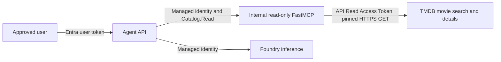
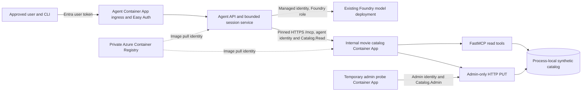

# Stage 2 architecture — agent and movie MCP

**Scope update, 2026-10-18:** TMDB replaces the synthetic catalog entirely. The current repository target is agent → authenticated read-only FastMCP → pinned TMDB search/details API; the hosted Container App still runs the older synthetic revision until a new image and TMDB secret are deployed. The detailed synthetic diagram and admin PUT evidence below describe that **older deployed revision**, not the target design. Current requirements are in [the TMDB integration record](tmdb-integration.md) and [Stage 2 task](tasks/stage-2-movie-mcp.md).

This document describes the implementation and test deployment as of 2026-10-18. The catalog contains invented records; it has no IMDb connection or external movie-data dependency. [Stage 2 validation](stage-2-validation.md) records what was actually exercised, and [the task](tasks/stage-2-movie-mcp.md) tracks the acceptance gates that remain open.

## System view

The two application services live in the existing `cae-az-maf-stage1` Container Apps environment in East US 2. The agent `ca-az-maf-stage1` has public HTTPS ingress protected by Container Apps Easy Auth and application authorization. The older catalog revision `ca-az-maf-movie-mcp` has **internal ingress only** and one replica, with FastMCP and the admin HTTP route in the same process. The temporary ingress-free `ca-az-maf-catalog-admin-probe` was deleted after the TMDB scope change; its role assignment and managed identity were also removed.

The agent uses a configured Foundry deployment for model inference. Model-selected movie reads are opt-in. The model can request only `search_movies` or `get_movie`; the application validates the requested tool, arguments, result, and per-run budget before using the MCP client. Explicit CLI and API movie reads use the same guarded client. The admin PUT is never registered as an MCP tool or agent route.

## Trust boundaries and permissions

| Boundary | Credential and policy | Resulting access |
| --- | --- | --- |
| User → agent API | Entra v2 user token for the Stage 1 API; Easy Auth checks issuer, audience, HTTPS, and allowed CLI client; the app checks the approved user | Session and chat routes, plus enabled movie-read route; no catalog write route |
| Agent → Foundry | Agent system-assigned managed identity with the project's Foundry User and account's Cognitive Services OpenAI User roles | Model inference on the configured deployment |
| Agent → catalog MCP | Agent system-assigned managed identity gets a catalog API token; catalog verifies signature, issuer, audience, tenant, exact agent object ID, and `Catalog.Read` role. Current source also requires a list-valued role claim; that hardening awaits rollout. | The two pinned read tools at `/mcp` |
| Admin probe → catalog PUT | Separate user-assigned managed identity gets a catalog API token; admin verifier checks signature, issuer, audience, tenant, exact admin object ID, and list-valued `Catalog.Admin` role | Complete replacement of an existing synthetic record at `PUT /movies/{catalog_id}` |
| Container Apps → registry | Separate image-pull identity with `AcrPull` | Pull pinned images; no catalog or Foundry data-plane permission |

The user token is not forwarded to the catalog. The agent identity has `Catalog.Read`, not `Catalog.Admin`. In the historical synthetic test, only the temporary probe used the admin identity; that probe and identity are now gone. The old catalog revision still has internal ingress and its admin route until the TMDB image replaces it. The previously observed `403` for a proposed agent `put_movie` was an **agent-boundary** denial.

The catalog API registration is `ddf8d97d-9b4a-4ce8-9fd2-a7293ad909cb`. `Catalog.Read` remains assigned to the agent object ID `71edeec2-8419-4709-9120-35b3f8f86067`. The old `Catalog.Admin` role definition still exists on the app registration, but its only assignment and the admin test identity were removed. These identifiers are configuration and audit references, not credentials. No bearer token, client secret, or user account is stored in this document.

## Read and write paths

For a movie read, the agent checks the operation name and exact arguments before requesting a token or opening a connection. The HTTP client accepts only the configured `https://...internal...azurecontainerapps.io/mcp` endpoint, does not follow redirects, checks the server's advertised tool schema against the pinned contract, and revalidates the response within an 8 KiB serialized limit. The catalog dispatcher checks its own reader allowlist and revocation state and reads from the bundled `synthetic-movies-v1` catalog. Model-selected reads permit at most two sequential attempts per run; each model attempt is charged to the existing ledger. Only the final user/assistant text pair enters session history.

For an admin replacement, FastAPI authenticates the bearer token independently of FastMCP. The service permits only the configured admin principal, validates the full movie schema and matching path/body ID, and replaces only an existing synthetic record. The catalog revision increments on success. The current catalog is process-local: its state is not durable and a replica restart resets it to the bundled baseline. One replica avoids cross-replica state divergence in this teaching deployment; it does not provide durable or multi-replica write semantics.

The local design and security tests cover unknown tools, extra arguments, invalid catalog results, reader revocation, malicious synopsis text that proposes a write, denied agent writes, invalid admin tokens, forged identity headers, malformed role claims, method override, mismatched IDs, and invalid replacement bodies. A denial must not mutate the catalog or advance its revision.

## Network architecture and acceptance limit

The existing environment was created without a VNet or workload profiles. It supports deploying the catalog as a second Container App, but it does **not** currently supply a user-defined-route outbound firewall policy. Internal catalog ingress, strict endpoint pinning, redirect refusal, and service authorization are separate protections; none proves that an arbitrary unapproved outbound destination is blocked by a network rule.

The Stage 2 network acceptance plan therefore has two parts:

1. Replace the old synthetic MCP image with the TMDB read-only image, configure its TMDB API Read Access Token as a Container App secret, and verify agent search/details through the real workload identity. The obsolete admin probe and identity have already been removed.
2. Review a workload-profiles Container Apps environment with VNet integration and controlled egress. Inventory required Foundry, Entra, DNS, registry/platform, configuration, secrets, telemetry, and catalog destinations before applying an outbound rule. Then prove the approved read path still works, a test-owned unapproved destination is blocked by the network rule, and endpoint/redirect escape is rejected. Record the rule version and distinguish a network block from an HTTP `401`/`403`.

No VNet, firewall, or alternate network foundation has been approved or deployed for this project. The [network design record](stage-2-network-design.md) describes a reviewable candidate and evidence plan. Stage 2 network acceptance must remain open until those deployed exercises pass.

## Current deployment and evidence

The agent's model-selected read passed on revision `ca-az-maf-stage1--0000010`. The catalog's current admin-enabled revision is `ca-az-maf-movie-mcp--0000001`, pinned to digest `sha256:209edec91beb1da58fd028601f7ea5a3a576c7f8d270f2d41f5963258c2b771d`. From the temporary probe, an admin-authorized direct PUT for `movie_000101` returned `200` and catalog revision `1`, changing the title to *Brass Comet Admin Test*. The hosted agent's ordinary MCP read regression passed after the catalog rollout, but it did not verify this changed record.

The synthetic read-after-write and direct PUT exercises were superseded by the TMDB-only decision. The probe was deleted; the old in-memory record will disappear when its revision is replaced. TMDB live reads, source attribution, token configuration, and controlled-egress checks are pending. The [validation record](stage-2-validation.md) contains historical results; the [change log](change-log.md) records rollout history.

## Implementation map

- Agent API, user authentication, budgets, and sessions: `apps/agent/src/az_maf_agent/api.py`, `core.py`, `client_auth.py`.
- Agent MCP endpoint validation, token acquisition, no-redirect transport, and result validation: `apps/agent/src/az_maf_agent/movie_mcp.py`.
- Model-selected read loop: `apps/agent/src/az_maf_agent/model_tools.py`.
- Catalog data, schemas, dispatcher, and admin service: `apps/movie-catalog-mcp/src/movie_catalog_mcp/catalog.py`.
- FastMCP server and mounted admin route: `apps/movie-catalog-mcp/src/movie_catalog_mcp/server.py`, `api.py`, `admin_auth.py`.
- Infrastructure definitions: `deploy/container-app.bicep`, `deploy/movie-mcp-app.bicep`.
