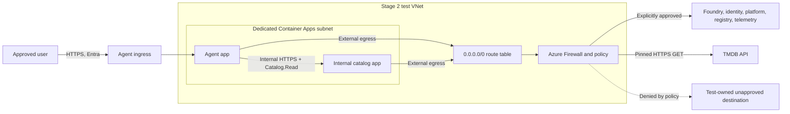

# Stage 2 network design and decision record

**Status:** proposed design for review; no new network foundation has been deployed. TMDB is now the sole movie source, so the old synthetic admin PUT references in this document are superseded. This record separates network enforcement from MCP authorization. It complements the [Stage 2 architecture](stage-2-architecture.md) and [validation record](stage-2-validation.md).

## Decision to make

Stage 2 requires a deployed test that permits the agent's approved MCP read and the MCP's pinned TMDB GET while blocking a test-owned unapproved outbound destination **by a network rule**. The current `cae-az-maf-stage1` environment has no VNet integration or workload profiles. Hosting a second internal Container App there works and has been verified, but it cannot demonstrate the required user-defined-route egress policy in its present configuration.

Microsoft's [Container Apps networking overview](https://learn.microsoft.com/en-us/azure/container-apps/networking) lists user-defined routes for workload-profiles environments. Its [Azure Firewall integration guidance](https://learn.microsoft.com/en-us/azure/container-apps/use-azure-firewall) states that UDR and controlled egress require that environment type and that the route table is configured outside the Container Apps environment. The [VNet integration guide](https://learn.microsoft.com/en-us/azure/container-apps/vnet-custom) specifies a dedicated `/27` or larger subnet for a workload-profiles environment. These are design inputs, not evidence that this subscription has capacity or that a particular deployment will succeed.

## Candidate topology

The proposed test foundation is a **new** workload-profiles Container Apps environment with VNet integration, a dedicated apps subnet, a route table that sends default outbound traffic to an Azure Firewall private IP, and a reviewed firewall policy. The agent and TMDB MCP would be deployed there as separate apps with the existing logical identity split and digest-pinned images. The MCP would retain internal ingress. No admin probe or write route is part of the new design.

This is a candidate, not an instruction to modify the current environment. Azure Firewall has a material running cost, so its SKU, expected test duration, data-processing estimate, and cleanup plan need a current price review and Azure what-if before deployment. A NAT gateway alone supplies stable outbound addresses but does not satisfy the requirement to deny a named unapproved destination by an allow/deny policy.

## Egress inventory before policy creation

The policy cannot be a guessed short allowlist. Record the actual destinations and protocol needs for the selected deployment, then compare them with Microsoft's [Azure Firewall dependency list](https://learn.microsoft.com/en-us/azure/container-apps/use-azure-firewall) and [VNet NSG guidance](https://learn.microsoft.com/en-us/azure/container-apps/firewall-integration). The initial inventory is:

| Dependency | Why it is needed | Review action |
| --- | --- | --- |
| Foundry model endpoint | Agent inference | Resolve the configured account/deployment endpoint and approved access path. |
| Microsoft Entra and managed identity | Token acquisition and validation key retrieval | Confirm required Azure Active Directory service tags/FQDNs and JWKS reachability. |
| Container Apps platform and Microsoft Artifact Registry | Environment operation and system images | Include Microsoft-documented platform destinations. |
| Private Azure Container Registry | Pull application images | Include registry and identity dependencies; consider private access separately. |
| DNS | Resolve internal catalog and approved external hosts | Confirm Azure or custom DNS behavior and required port 53 path. |
| Log Analytics and monitoring | Existing diagnostics | Include telemetry only as configured and verify logs continue. |
| Internal movie MCP | Agent MCP reads | Preserve private service reachability; its authorization is enforced by the MCP. |
| TMDB API, if enabled | External movie search and details | Review `api.themoviedb.org` as a distinct, credentialed outbound destination and verify only the pinned read paths are used. |
| Test-owned unapproved host | Negative egress exercise | Use a controlled endpoint and verify no request reaches it. |

Microsoft's guidance identifies `MicrosoftContainerRegistry` and `AzureFrontDoorFirstParty` for Artifact Registry, `AzureContainerRegistry` and `AzureActiveDirectory` for ACR, and `AzureActiveDirectory` for managed identity, depending on whether application or network rules are used. These broad service tags are platform dependencies; they are not evidence of an application-level allowlist. The exact policy and rule priorities remain to be designed and reviewed.

## Acceptance evidence

The deployed tests should record time, source app/revision, identity, destination, method, rule/policy version, and result without logging tokens or movie payloads:

1. An approved user can make a normal agent request; the agent obtains its own catalog token and reads through `/mcp`. Foundry inference and required platform dependencies remain healthy.
2. The same runtime attempts a request to the test-owned unapproved destination. The route shows traffic traversed the firewall, the firewall log records a deny, and the destination confirms it received no request. An application-level URL validator denial alone does not satisfy this case.
3. The agent proposes an unknown or write tool and is denied before dispatch. A direct request to a guessed MCP write path finds no registered write operation. Confirm the MCP's TMDB token cannot authorize a TMDB user write; no user session or write credential is configured.
4. The agent's pinned MCP client rejects a changed endpoint or redirect. A controlled redirect test must confirm no credential is forwarded to the new host. The network policy should independently deny an unapproved redirect destination when the test bypasses the application validator.
5. A public caller cannot reach the internal MCP; an internal caller without a catalog token gets `401`. No alternative public API route bypasses authentication.

Do not infer a network deny from `401`, `403`, `404`, DNS failure alone, or an agent-dispatcher rejection. Correlate firewall logs and destination observation with the application result. Preserve the actual rule identifiers, but redact bearer tokens and request bodies.

## Rollout and cleanup sequence

1. Confirm subscription quota, target region, IP ranges, DNS plan, and current pricing. Prepare Bicep for VNet/subnets, route table, firewall/policy, Log Analytics connection, and workload-profiles environment. Run validation and what-if; review monthly and short-lived test costs.
2. Deploy the network foundation and app images with a permissive observation policy long enough to discover required platform traffic. Tighten to the reviewed policy, then run the five acceptance exercises above.
3. If the foundation is only for a short exercise, delete its billable firewall and related resources after evidence is saved. Retain the architecture and redacted results in the repository.

No production migration or cutover is implied by this proposal. The existing Stage 1 deployment remains the current working test system until a separate reviewed change replaces it.
