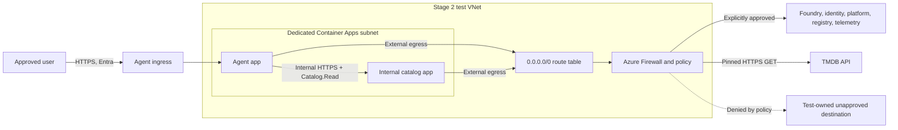

# Stage 2 network design and decision record

**Status:** the separate workload-profile NSG test was deployed and the targeted network deny was observed on 2026-10-18 CDT. The working Stage 1 apps were not migrated. TMDB is the sole movie source. This record separates network enforcement from MCP authorization and preserves the narrower scope of the test. It complements the [Stage 2 architecture](stage-2-architecture.md) and [validation record](stage-2-validation.md).

## Reason for a separate environment

Stage 2 requires a deployed test that permits the agent's approved MCP read and the MCP's pinned TMDB GET while blocking a test-owned unapproved outbound destination **by a network rule**. The current `cae-az-maf-stage1` environment has no VNet integration or workload profiles. Hosting a second internal Container App there works and has been verified, but it cannot demonstrate the required user-defined-route egress policy in its present configuration.

Microsoft's [Container Apps networking overview](https://learn.microsoft.com/en-us/azure/container-apps/networking) lists user-defined routes for workload-profiles environments. Its [Azure Firewall integration guidance](https://learn.microsoft.com/en-us/azure/container-apps/use-azure-firewall) states that UDR and controlled egress require that environment type and that the route table is configured outside the Container Apps environment. The [VNet integration guide](https://learn.microsoft.com/en-us/azure/container-apps/vnet-custom) specifies a dedicated `/27` or larger subnet for a workload-profiles environment. These are design inputs, not evidence that this subscription has capacity or that a particular deployment will succeed.

## Selected narrow network test

The [Bicep module](../infra/modules/stage2-egress-test-foundation.bicep) created a new Consumption workload-profile environment, dedicated delegated `/27` subnet, VNet, and NSG in the existing resource group. The NSG's priority-100 outbound rule targeted HTTPS to `20.14.237.110/32`, the static public IP of the test-owned Stage 1 agent. DNS for that agent hostname resolved to the same IP immediately before deployment. Default outbound rules remained in effect for other destinations so Foundry, Entra, ACR, TMDB, DNS, and telemetry could continue to work. This was a **single-destination denial test**, not a general FQDN allowlist or production egress policy.

The Bicep compiler passed. Azure what-if predicted exactly four creations—`cae-az-maf-stage2-nettest`, `nsg-az-maf-stage2-apps`, `vnet-az-maf-stage2-nettest`, and its delegated apps subnet—and no changes to the six existing resources it listed. The deployed environment reused the existing Log Analytics workspace. A second what-if predicted exactly two test-app creations and no existing-resource changes.

The official [Container Apps billing guide](https://learn.microsoft.com/en-us/azure/container-apps/billing) says a Consumption-only workload profile has no dedicated-plan management charge; the monthly free grants are shared across the subscription. The [Azure retail price API](https://prices.azure.com/api/retail/prices) listed East US 2 active rates of $0.000024 per vCPU-second and $0.000003 per GiB-second on 2026-10-18. Two 0.5-vCPU, 1-GiB replicas continuously active for one hour would therefore be about **$0.11 before any remaining free grant**, plus public-IP, logging, data-transfer, and request charges if applicable. [Azure says VNets are free](https://azure.microsoft.com/en-us/pricing/details/virtual-network/); NSGs have no separate resource charge. Actual subscription billing must be checked after deployment. Keep the test short-lived and remove the extra apps and foundation after recording evidence.

The [duplicate-app module](../infra/modules/stage2-egress-test-apps.bicep) deployed digest-pinned agent and TMDB MCP apps in the new environment, with private MCP ingress, the existing image-pull identity, and a secure TMDB token parameter. The new agent system identity received account-scoped Foundry inference, project-scoped Foundry User, and catalog API `Catalog.Read` assignments for the test. The MCP accepted only that new agent principal. The duplicate agent had public HTTPS ingress with its own signed-Entra-token and user-allowlist application checks; the existing agent retained its separate Easy Auth boundary. Anonymous, wrong-audience, and forged-header requests to the duplicate agent returned `401`.

The direct egress probe from agent revision `ca-az-maf-agent-nettest--imlae64` established a before/after baseline. With the test rule temporarily set to Allow, the test-owned Stage 1 `/about` endpoint returned HTTP `401`. After the same priority-100 rule was switched to Deny, a new direct HTTPS connection to the DNS-confirmed `/32` timed out in 8.1 seconds; direct HTTPS to TMDB still returned HTTP `401` in 0.3 seconds. Authenticated movie reads and Foundry chats also continued to pass after the deny. The rule ID was `/subscriptions/f39e7f3b-fae5-400b-86d9-1dfe9d45f048/resourceGroups/rg-az-maf-stage1/providers/Microsoft.Network/networkSecurityGroups/nsg-az-maf-stage2-apps/securityRules/deny-test-owned-destination-https`. The [validation record](stage-2-validation.md) has the surrounding identity, auth, and telemetry checks. No NSG flow log or destination access log was captured, so the evidence is limited to this controlled destination and before/after connection result.

## Higher-assurance firewall alternative

The broader alternative is a **new** workload-profiles Container Apps environment with VNet integration, a dedicated apps subnet, a route table that sends default outbound traffic to an Azure Firewall private IP, and a reviewed firewall policy. The agent and TMDB MCP would be deployed there as separate apps with the existing logical identity split and digest-pinned images. The MCP would retain internal ingress. No admin probe or write route is part of the new design. This is not the selected narrow test because its always-running firewall has a material cost.

Azure Firewall remains an option for a broader FQDN-based policy. Its SKU, expected test duration, data-processing estimate, and cleanup plan would need a separate current price review and Azure what-if before deployment. A NAT gateway alone supplies stable outbound addresses but does not satisfy the requirement to deny a named unapproved destination by an allow/deny policy.

## Inventory for any broader policy

The policy cannot be a guessed short allowlist. Record the actual destinations and protocol needs for the selected deployment, then compare them with Microsoft's [Azure Firewall dependency list](https://learn.microsoft.com/en-us/azure/container-apps/use-azure-firewall) and [VNet NSG guidance](https://learn.microsoft.com/en-us/azure/container-apps/firewall-integration). The initial inventory is:

| Dependency | Why it is needed | Review action |
| --- | --- | --- |
| Foundry model endpoint | Agent inference | Resolve the configured account/deployment endpoint and approved access path. |
| Microsoft Entra and managed identity | Token acquisition and validation key retrieval | Confirm required Azure Active Directory service tags/FQDNs and JWKS reachability. |
| Container Apps platform and Microsoft Artifact Registry | Environment operation and system images | Include Microsoft-documented platform destinations. |
| Private Azure Container Registry | Pull application images | Include registry and identity dependencies; consider private access separately. |
| DNS | Resolve internal catalog and approved external hosts | Confirm Azure or custom DNS behavior and required port 53 path. |
| Log Analytics and monitoring | Existing diagnostics | Include telemetry only as configured and verify logs continue. |
| Internal movie MCP | Agent MCP reads | Preserve private service reachability; its authorization is enforced by the MCP. |
| TMDB API, if enabled | External movie search and details | Review `api.themoviedb.org` as a distinct, credentialed outbound destination and verify only the pinned read paths are used. |
| Test-owned unapproved host | Negative egress exercise | Use a controlled endpoint and verify no request reaches it. |

Microsoft's guidance identifies `MicrosoftContainerRegistry` and `AzureFrontDoorFirstParty` for Artifact Registry, `AzureContainerRegistry` and `AzureActiveDirectory` for ACR, and `AzureActiveDirectory` for managed identity, depending on whether application or network rules are used. These broad service tags are platform dependencies; they are not evidence of an application-level allowlist. The exact policy and rule priorities remain to be designed and reviewed.

## Evidence criteria

The [validation record](stage-2-validation.md) gives the redacted live results and their limits. These criteria guided the controlled run without logging tokens or movie payloads:

1. An approved user can make a normal agent request; the agent obtains its own catalog token and reads through `/mcp`. Foundry inference and required platform dependencies remain healthy.
2. The same network runtime attempts a request to the test-owned unapproved destination. The resolved IP must match the NSG's `/32` rule, the connection must fail after the network rule is applied, and a permitted control destination must still respond. A probe run before the rule or equivalent NSG evidence should distinguish network denial from application validation. The destination should confirm it received no request. An application-level URL validator denial alone does not satisfy this case.
3. The agent proposes an unknown or write tool and is denied before dispatch. A direct request to a guessed MCP write path finds no registered write operation. Confirm the MCP's TMDB token cannot authorize a TMDB user write; no user session or write credential is configured.
4. The agent's pinned MCP client rejects a changed endpoint or redirect. A controlled redirect test must confirm no credential is forwarded to the new host. The network policy should independently deny an unapproved redirect destination when the test bypasses the application validator.
5. A public caller cannot reach the internal MCP; an internal caller without a catalog token gets `401`. No alternative public API route bypasses authentication.

Do not infer a network deny from `401`, `403`, `404`, DNS failure alone, or an agent-dispatcher rejection. Correlate the NSG rule and before/after or control-destination observation with the application result. Preserve the actual rule identifiers, but redact bearer tokens and request bodies.

## Completed rollout and cleanup

1. Rechecked the test-owned destination's static IP and DNS, compiled both templates, and reviewed Azure what-if before deployment.
2. Deployed the separate environment and digest-pinned agent/MCP test apps with a private secure parameter file, which was deleted after deployment. Assigned temporary Foundry and `Catalog.Read` permissions to the new agent identity. Confirmed approved TMDB/Foundry paths and the controlled NSG allow-then-deny result.
3. Saved redacted evidence. Deleted the temporary app-role and Foundry assignments, both duplicate apps, the environment, VNet/subnet, and NSG. Verified the resource group contained no `nettest` resources and the Azure-managed backing group was gone. The original Stage 1 hosted movie read still passed after cleanup.

No production migration or cutover is implied. The existing Stage 1 deployment remains the current working test system.
