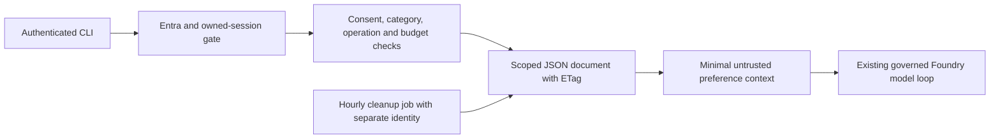

# Stage 4 — Governed movie preferences

The selected pattern is a structured document per authenticated user and purpose in
Azure Blob Storage. Vector, graph, embedding, summary, and automatic transcript
storage are not enabled. Exact genre/language preferences do not need semantic
search or relationships; those alternatives add derived-data deletion and isolation
work without improving this exercise.

## Approved policy and data flow

The user approved explicit consent, preferences shared across that user's sessions,
a 30-day expiry, and no dev backups/version history. The two allowed categories are
`preferred_genre` (action, animation, comedy, documentary, drama, science_fiction)
and `preferred_language` (en, es, fr, ja). All other values, extra identity fields,
arbitrary text, connection strings, and query operations are rejected.



API identity comes from the verified token and owned session, never the request
body, skill, model, or headers claiming identity. The Blob object name is a hash of
trusted tenant/user/purpose scope. Production credentials and transcripts are never
memory categories. Each record includes provenance, user-declared confidence,
creation/update/expiry times, revision, consent-policy version, and source-session
metadata. Recall sends only category/value pairs, marked as untrusted user data.
Memory cannot grant tools, change policy, or provide consent. Application recall has read-only inspection capability. The reviewed Stage 3 skills
have no memory capability: they receive neither saved preferences nor earlier
personalized history, and cannot supply another user's scope.

## Lifecycle and concurrency

Creation uses `If-None-Match: *`; updates use `If-Match` with the exact ETag. Conflicts
fail without blind retries. An uncertain write requires inspection to reconcile its
outcome. Forget retains an empty generation document so a stale create cannot
resurrect old state. Correction requires both namespace generation and record
revision, renews the 30-day expiry, and never recreates a deleted ID.

Expired values are excluded immediately by every read. The hourly cleanup job removes
expired record bodies from live documents and retains their advanced generation.
It scans only the approved prefix, at most 100 pages of 50 documents, within a
480-second work deadline and 600-second replica timeout. ETag conflicts fail the job
rather than overwriting a concurrent correction. The platform retries once; the next
hourly execution retries from storage. This is a small dev teaching deployment with
one approved user, not an unlimited cleanup service. Investigate failed or overdue
executions before the 24-hour physical-cleanup target is breached; outages or a
namespace exceeding these bounds require operator intervention.

There are no derived indexes, embeddings, personal-data caches, replicas maintained
by the app, or backups to propagate deletion into. Blob versioning and both soft-delete
features are disabled in dev. Empty fencing documents and content-free audit metadata
remain. Enabling backup/restore later requires a separate deletion-fencing review;
restoring old preference documents is unsupported.

Each recalled run binds its working history to the current memory generation.
Correction, deletion, or expiry changes the generation and invalidates older working
history before the next model call. A final fresh read rejects an answer if memory
changed while the model ran. Preference records themselves are never copied into
session history. Previously displayed answers cannot be retracted from a user's
terminal. `/reset` clears working history and leaves durable preferences and budgets
intact.

## Bounds and cancellation

The policy allows eight memory operations per session. A recalled turn reserves two
operations for retrieval and its final freshness check; explicit owner deletion stays
available after the budget is exhausted. Model context, tokens, tools, retries, and
spend retain their existing run ledger limits. Retrieval has no embedding spend.

Storage runs off the event loop. At most four workers may remain pending, with one
per user namespace. Requests time out after 15 seconds. Cancellation prevents a later
PUT when observed before dispatch; an already-dispatched PUT may have committed.
Its worker keeps its slot until it settles, and no retry is issued. Socket/stream
bounds remain active. Shutdown drains pending workers before closing credentials.
Audit authorization must be delivered before effects; the dev Log Analytics workspace
retains content-free metadata for 30 days. Logs omit preference values,
raw tokens, model responses, and prompts.

## Learner exercise

Run the authenticated chat CLI against dev with the existing encrypted token cache:

```sh
uv run --locked agent-chat --api https://ca-maf-agent-dev-eus2-01.kindisland-49d1cad2.eastus2.azurecontainerapps.io --movies
```

- `/memory` inspects records, IDs, generation, revision, and expiry.
- `/remember preferred_genre comedy` explicitly consents to save for 30 days.
- Ask for a recommendation. The agent can use the saved preference across sessions.
- `/remember preferred_genre drama` explicitly corrects the existing category.
- `/forget RECORD_ID` deletes one record; `/forget all` removes all preferences.
- Start a fresh session when its operation budget is exhausted. Reset does not refill it.

Typing a preference in ordinary chat never saves it. The explicit `/remember` command
constitutes consent; the CLI inspects the latest generation/revision before writing.
Concurrent changes may produce a conflict; inspect and decide again rather than retry
blindly. TMDB catalog knowledge remains separate and read-only.

## Deployment and operations

Dev uses `stmafmemdevmako261019`, container `preferences`, and hourly job
`job-maf-memory-dev-eus2-01`. The agent and job use separate system identities with
container-scoped Blob Data Contributor. Registry authentication reuses the existing
user-assigned pull identity; memory code selects the system identity.
Shared Key and anonymous Blob access are disabled; HTTPS, TLS 1.2 and storage
encryption are required. Account/container/policy/user allowlist come from operator
settings; unsupported configuration fails startup.

`infra/main.dev.bicepparam` enables dev memory. `main.rg.bicep` wires storage,
agent settings, and cleanup job. `main.bicep` exposes the same optional modules for
other environments, where memory remains disabled until separately approved.
Operator bootstrap uses `infra/modules/blob-data-roles.bicep` (or
`bootstrapMemoryRoles=true` with authorized role-assignment rights). Ordinary GitHub
OIDC deployment does not assign roles. Agent-only deployments also update the dev
cleanup job image to the same digest.

Inspect cleanup health with:

```sh
az containerapp job execution list -g rg-maf-dev-eus2-01 -n job-maf-memory-dev-eus2-01 -o table
az containerapp job start -g rg-maf-dev-eus2-01 -n job-maf-memory-dev-eus2-01
```

A successful job emits `memory_cleanup_completed` with counts only. The portal alert
`al-maf-memory-cleanup-dev-eus2-01` evaluates hourly and fires when no success marker
has arrived in 20 hours. It has no external notification recipients; an operator must
monitor Azure alerts. Its query counts heartbeat metadata, never preference contents. On failure,
inspect identity access, ETag contention, corrupt documents, and scan/time bounds.
Do not repair by unconditional overwrites or restoring a deleted document. Keep the
24-hour cleanup target visible during dev operation and disable writes if it cannot
be maintained. See the retained Stage 4 validation report for release evidence.
