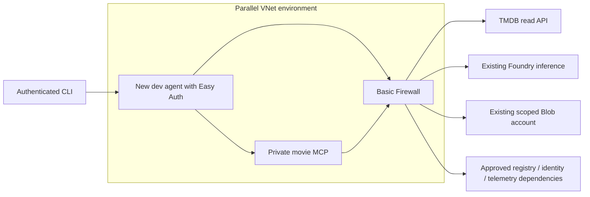

# Dev controlled-egress migration review

Prepared 2026-10-19 at the user's request. **Phase-one deployment approved and in progress; no registry upgrade or app migration authorized yet.** The working dev environment, registry, app URLs, identities, preferences, control policy and session data remain unchanged by this package.

## Proposed first phase

Deploy [dev-network.bicep](../infra/dev-network.bicep) and [its parameters](../infra/dev-network.bicepparam) into `rg-maf-dev-eus2-01`. The module is [controlled-egress.bicep](../infra/modules/controlled-egress.bicep). It creates a parallel workload-profile Container Apps environment `cae-maf-dev-eus2-02`, one VNet, the delegated application subnet, Basic Firewall with its policy/rules, two Standard public IPs, an NSG, a default route through the firewall, and firewall diagnostics to the existing workspace.

Azure what-if succeeded with **11 creates, zero modifications, zero deletions**; inline firewall/management subnets are included in the VNet resource. See [exact what-if resource IDs](validation/stage-5-evidence/network-what-if.json). This first phase creates no app or workload role assignment and does not cut over traffic. `10.83.0.0/24` was checked against the subscription's current VNet inventory; recheck immediately before deployment.

The first-phase foundation alone does not pass the network gate. The new apps, registry prerequisite, identity bootstrap, all five live network cases, and controlled cutover are subsequent steps.

## Cost requiring deployment approval

Official Azure Retail Prices API queried for East US 2, USD consumption rates on 2026-10-19:

| Item | Rate | Example |
| --- | --- | --- |
| Basic Firewall deployment | $0.395/hour | $9.48/day; $288.35 for 730 hours |
| Basic Firewall processed data | $0.065/GB | Depends on traffic |
| Current Basic ACR | $0.1666/day | Existing cost |
| Premium ACR prerequisite for later cutover | $1.6666/day | Increment of $1.50/day over current Basic |

The eventual firewall plus registry upgrade has a **base incremental cost of about $333.98 per 730-hour month**, before public IPs, environment networking infrastructure, data processing, logging, bandwidth, app compute and model inference. This is a planning subtotal, not an all-inclusive quote. Regional/account discounts and future prices may differ. Firewall charges continue while provisioned even with no learner requests; stop application replicas alone does not remove them.

[Meter evidence](validation/stage-5-evidence/network-retail-prices.json) was obtained from the [official Retail Prices API](https://prices.azure.com/api/retail/prices). Use service filters `Azure Firewall` / `Container Registry`, `armRegionName=eastus2`, `priceType=Consumption`, currency USD to reproduce it. The first phase does **not** upgrade ACR; that is a separate reviewed change before app cutover.

## Egress contract

The delegated app subnet sends `0.0.0.0/0` to the firewall. HTTPS is allowed by the NSG only in combination with that required route; an NSG HTTPS rule alone does not restrict destinations. All other outbound protocols are denied except internal environment traffic and Azure platform DNS. Basic Firewall uses HTTPS application rules with SNI host matching and Azure DNS, without TLS inspection or DNS proxy.

Allowed application hosts are the exact TMDB API, Foundry inference account, memory/control Blob account, registry login and dedicated regional data endpoint, telemetry ingestion host, management API for read-only skill controls, and documented Container Apps bootstrap/image dependencies. The policy does not permit `*.blob.core.windows.net` or arbitrary internet HTTPS. Platform identity, monitoring and Microsoft registry/front-door service tags remain explicitly documented shared-service exceptions. They are not a claim of tenant-specific isolation or universal exfiltration prevention. HTTPS method/argument authorization remains enforced by the application and downstream service.

Current Basic ACR has no dedicated data endpoint. A later Premium upgrade is required for the planned registry-specific endpoint, avoiding a broad Blob wildcard. The foundation can be created first, but app image pulls behind its restrictions must not begin before that prerequisite is completed and source/CI registry settings preserve it.

References: [Container Apps firewall/UDR requirements](https://learn.microsoft.com/en-us/azure/container-apps/use-azure-firewall), [network dependencies](https://learn.microsoft.com/en-us/azure/container-apps/firewall-integration), [Firewall SKU capabilities](https://learn.microsoft.com/en-us/azure/firewall/features-by-sku), [dedicated ACR endpoints](https://learn.microsoft.com/en-us/azure/container-registry/container-registry-dedicated-data-endpoints).

## Subsequent reviewed phases and rollback

1. Make Premium registry/data-endpoint settings reproducible in the foundation and deployment workflows before enabling them, so a later CI foundation update cannot downgrade the registry. Preserve image digests and existing pull grants.
2. Deploy parallel app names ending `-02`, with the same protected API audience and private MCP ingress. Keep shared controls stopped during bootstrap. Reuse the existing approved memory/session/control stores; do not copy or reset user state.
3. Bootstrap the new agent's policy Reader, state/session Writer, audit Writer, preference Contributor, scoped monitoring publisher, read-only skill-control Reader, and the user-required **Foundry User** role on the existing Foundry account. Bootstrap a separate cleanup job with only the required cleanup access. The MCP workload retains only approved catalog-read authority. Runtime identities receive no policy/operator/control-plane write role.
4. Review Key Vault references/rotation and precise role/secret changes separately. No secret values belong in parameters committed to Git, what-if evidence, logs or chat.
5. Prove authorized model/MCP/Blob/identity/telemetry paths; blocked test-owned egress with correlated firewall denial; reachable-host forbidden PUT; endpoint/redirect escape denial; and private MCP ingress/auth protection. Use every active revision and both runtime contexts. An application denial or unrelated timeout does not substitute for a firewall denial.
6. Re-run containment, concurrent/resumable sessions, deletion/cleanup, live evaluation and the stopped-restart/recovery canary under the final topology. Only then change the learner endpoint and CI target. Keep the old apps available for controlled rollback until the new deployment passes.
7. Rollback selects the previous endpoint/digest while preserving stopped policy epochs, reservations, audit and user state. It does not downgrade/delete shared accounting. After approved observation, retire old apps/environment and the synthetic stop fixture; keep only the intended network foundation. Cleanup must explicitly account for firewall/public-IP charges.

The user explicitly approved phase one after reviewing the eleven creates and recurring charges; deployment `stage5-network-foundation` is in progress. No current production-network completion claim is made.

## Registry prerequisite review (separate approval)

[registry-networking.bicep](../infra/modules/registry-networking.bicep) has a successful what-if showing one existing registry modification with exactly two property changes: `sku.name` Basic → Premium and `dataEndpointEnabled` false → true. Existing anonymous-pull, Microsoft-managed encryption mode and ARM authentication settings are explicitly preserved. No repositories, grants, app names or traffic endpoints are deleted or moved.

The incremental registry rate is **$1.50/day** (about **$45.63 per 730-hour month**). The prepared workflow and foundation templates read the dev environment variable `MAF_REGISTRY_SKU`; setting it to `Premium` makes future deployments preserve the required tier and dedicated data endpoints. Default behavior stays Basic until that reviewed variable change is approved. Existing login server and digest-pinned images stay valid. App migration/Key Vault/RBAC changes remain a subsequent review.

## Latest deployment and registry decision

The user approved phase one, and deployment `stage5-network-foundation-retry` succeeded. The first attempt failed because Azure does not support an Allow rule with the `AzurePlatformDNS` service tag. The repaired NSG uses the documented platform DNS address `168.63.129.16`; the NSG repair and foundation retry succeeded. Existing app traffic was not moved.

The user declined the separately proposed registry upgrade. Keep `crmafdevmako261018` Basic and leave the dev `MAF_REGISTRY_SKU` variable unset (default Basic). The Premium what-if and module are review artifacts, not deployment authorization. The dedicated-endpoint design above is therefore blocked for app cutover. Prepare another reviewed image-delivery design before moving apps; do not broaden storage egress or upgrade the registry implicitly. The approved Firewall foundation remains provisioned and incurs its approved recurring charges.
