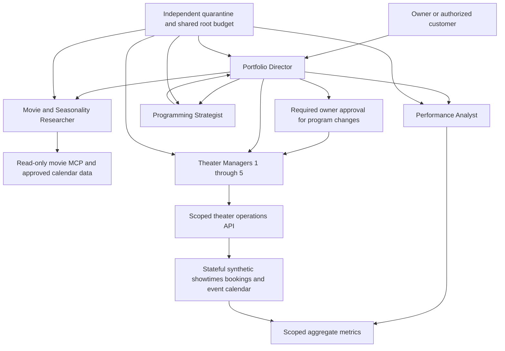

# Stage 11: Five-theater business agent orchestration

Status: **planned**, 2026-10-20. The user expanded the initial single-event planning example into an owner-operated business with five theater locations. No agents, booking backend, new identities or live commercial integrations are provisioned.

[All stages](../README.md) · [Tasks](../../tasks/stage-11-movie-orchestration.md) · [Validation plan](validation/README.md) · [Stage 10 framework adoption](../stage-10/README.md)

## Business outcome and user stories

An owner manages five theater locations, each with its own screens, capacity, calendar and local demand. The agent system helps manage showings and reservations/appointments, identifies underperforming and successful films, and recommends the next program using observed demand, costs and seasonality.

- “Which films are filling seats at each theater, and which showings are underperforming?”
- “Suggest next month's program for all five locations, accounting for Halloween or Christmas, local audiences and our past results.”
- “Show the expected contribution and uncertainty of replacing this screening; let me review the change before publication.”
- “Find availability and make a reservation/appointment at this theater, then confirm what actually committed.”

Treat “five theaters” as five locations, potentially with multiple screens; configure the actual screen layout later. The user selected both ticket reservations and private/group-event bookings. Proposed first implementation uses a stateful synthetic theater-business backend with real test bookings/showtimes; it is not just invented availability in a chat response. Live ticket systems, real customer data and payments are separate integration/approval decisions.

## Personas and responsibilities

| Agent/persona | Instances | Responsibility and bounded authority |
| --- | --- | --- |
| Portfolio Director — owner's orchestrator | One | Understand owner requests, coordinate only needed agents, compare portfolio options, request required approvals and assemble a grounded decision/report; no direct policy/identity control or blanket write authority |
| Theater Manager | Five, one per location | Inspect and manage that location's showings, screen calendar, capacity and approved reservation/appointment operations through scoped tools; cannot inspect private data or alter schedules/bookings at another location |
| Movie and Seasonality Researcher | One shared specialist | Approved TMDB movie facts and reviewed seasonal/calendar signals; propose Halloween/Christmas/other-theme candidates without treating a holiday as guaranteed demand |
| Performance Analyst | One shared specialist | Read approved aggregate attendance, capacity, reservations/cancellations, revenue and cost data; compare films/showings/locations and explain evidence quality; no raw customer/PCI access or write authority |
| Programming Strategist | One shared specialist | Produce location-specific programming/showtime proposals from verified facts, historical metrics, seasonal signals and operational constraints; cannot publish, book or authorize itself |

This is nine logical agents in the full five-location design, not nine model calls on every request. Instantiate/invoke only the roles needed by a bounded task. The Performance Analyst also consumes deterministic pricing calculations; the Programming Strategist presents constrained ticket-price recommendations for owner review. Stage 10 owns common framework evaluation; Stage 11 selects the A2A domain/role contracts. Real independently containable agents require distinct Entra Agent IDs and authenticated service boundaries; persona prompts alone are insufficient.

Deterministic backend services—not an LLM “safety agent”—enforce seat/capacity availability, time conflicts, prices/amounts, exact-action approvals, ownership, tenant/location scope, version checks and state transitions. Deterministic analytics compute business metrics; agents explain and propose from those results.

## Default five-location simulation

[Machine-readable defaults](simulation-defaults.json) define **two small, two medium and one large location**. These are configurable teaching profiles, not official industry size classifications. Distinguish venue totals from individual auditoriums:

| Profile | Locations | Screens per location | Seats per screen | Seats per location | Portfolio seats |
| --- | --- | --- | --- | --- | --- |
| Small | 2 | 2 | 80 | 160 | 320 |
| Medium | 2 | 4 | 150 | 600 | 1,200 |
| Large | 1 | 8 | 250 | 2,000 | 2,000 |
| Total | 5 | 20 screens total | Varies | Varies | 3,520 |

For scale references, [BFI advertises auditoriums from 38 to 450 seats](https://www.bfi.org.uk/venue-hire/screenings), and [ODEON Northwich lists five screens with capacities from 81 to 235](https://www.odeon.co.uk/corporate-events/venue-finder/northwich-barons-quay/). Those are real venue examples, not evidence that our small/medium/large profiles are a universal standard or actual available inventory.

Default simulation currency is USD and venue time zone is America/Chicago; both are configurable. Default holds expire after ten minutes, screen turnaround is twenty minutes and a private/group event blocks the selected screen/time interval. Sellable inventory excludes unavailable seats; accessibility/maintenance configuration must be modeled explicitly rather than assumed to add capacity. All contacts, attendance, costs and bookings start synthetic; **payments are disabled**.

## Simulated ticket-price recommendations

Select the best candidate price **under the declared simulated demand/cost model**, not a universally correct ticket price. Start from a $12 reference price; evaluate $8–$18 in $0.50 increments. Size alone is not a reason to charge more. The model consumes sellable capacity, venue/time/film demand history, seasonality, cancellations, competitive/user-supplied signals if approved, and known costs. Initial numeric inputs below are invented scenario parameters, not current market prices or measured elasticity.

Initial one-screen expected attendance at $12 is 65%/60%/55% for small/medium/large profiles. Each $1 increase reduces expected demand by 5% of that screen's capacity; cap predicted attendance between zero and capacity. Default ticket distributor share is 50%, concession contribution $3 per attendee, variable cost $1 per attendee and fixed showing costs $60/$100/$150. These are editable teaching assumptions; missing real costs would prevent a real net-profit claim.

`expected contribution = expected attendees × (ticket price × (1 − distributor share) + concession contribution − variable cost) − fixed showing cost`

For the ordinary scenario, the documented candidate grid yields these illustrative results **for one showing on one screen**, before any extra real-world costs/taxes:

| Screen profile | Candidate ticket price | Expected attendees | Expected contribution |
| --- | --- | --- | --- |
| Small — 80 seats | $10.50 | 58 | $360.50 |
| Medium — 150 seats | $10.00 | 105 | $635.00 |
| Large — 250 seats | $9.50 | 168.75 | $989.06 |

Fractional attendance is an expectation, not a fractional seat booking. These values are reproducible arithmetic examples, not measured sales, production forecasts or accepted Stage 11 results. Synthetic seasonal scenarios initially multiply baseline demand by 1.25 for a Halloween/horror match or 1.20 for a Christmas/holiday match; actual seasonal effects need historical validation and uncertainty intervals. Compare current-price, simple-rule and no-seasonality baselines, not only an optimizer's chosen result.

The deterministic optimizer evaluates the approved bounded grid, constraints and assumptions; the agent explains alternatives and uncertainty. Prices are recommendations until an authorized owner publishes them. Keep current quotes locked for the hold lifetime, never reprice committed reservations, reject manipulative or out-of-range tool arguments, avoid protected-attribute/personal-data personalization, and make currency/tax/fee assumptions explicit. Private/group-event quotes use a separately reviewed capacity/opportunity-cost policy and staff approval; do not treat a ticket grid as an event-contract price. Simulated booking/price records never call a payment gateway or collect payment credentials.

## Proposed architecture

Business-review flow: director requests aggregate performance and seasonal/movie research; strategist proposes a per-location program; director presents the evidence and required owner approval; only then does the location's manager request a scoped backend mutation. Reservation flow: check authoritative backend availability → create a bounded hold → confirm or expire/cancel according to the reviewed policy. Do not route routine reservations through every specialist. The customer API and owner/staff API have distinct authorization.

Use a bounded directed workflow. First-scope proposal: delegation depth one, at most two concurrent children, no manager-to-peer delegation and no arbitrary agent discovery/callback endpoints. Each request has a reviewed role/call plan that fits existing run/user/day token, time, tool and spend limits. A whole-portfolio task that cannot fit must clarify/reduce scope or use an explicitly authorized durable work plan; it cannot multiply budgets by starting hidden child roots or silently raise the eight-attempt/$0.25 run ceiling.

Evaluate Microsoft Agent Framework A2A client/hosting against the selected Python/protocol version and authenticated task lifecycle. If internal typed HTTP is used instead, label it accurately; do not claim protocol compliance from local function calls. MCP remains agent-to-tool access. Preserve parent/child/root identity and structured artifact provenance in privacy-safe traces.

## Theater operations and appointments

The backend is the source of truth for published showtimes, locations/screens, seats/capacity, holds, confirmed reservations, cancellations and selected private-event appointment states. Synthetic teaching data can exercise real application transactions without claiming connection to a real cinema. Customer contact details are minimized/synthetic initially; Stage 9 governs any later real PII/receipt collection. Reservations need not take payment.

Inventory state transitions and roles before adding tools. Enforce atomic seat/capacity allocation, expiring holds, venue time zones, screen turnaround/maintenance, exact idempotency and current versions. Confirm only committed backend state; an accepted request, agent statement or drafted schedule is not a booking. Handle duplicate confirmation, conflicting holds, appointment/screen overlaps, crash/retry and uncertain commits without double booking or inventing success.

Published-program changes, bulk cancellation and consequential overrides need a reviewed human-approval policy bound to actor, location, operation, payload digest and current version. Routine permitted customer reservations use reviewed deterministic policies; do not require a fresh owner approval for every harmless operation by default. Booking consent/ownership never grants rights to change a movie program or another customer's records. No payment/refund/reimbursement processing is selected.

The TMDB MCP stays read-only. A separate operations API/MCP adapter is the proposed home for reviewed business writes; do not disguise them as new movie-catalog writes. Verify exhibition rights, distributor availability and any real showtime/ticket integration independently before live publication. Our existing non-commercial TMDB teaching usage is not authorization for a commercial deployment.

## Performance, seasonality and programming decisions

Use timestamped theater-owned facts: venue/screen, movie/showtime, sellable capacity, attended/sold/reserved seats (kept distinct), cancellations/no-shows, ticket/concession revenue and reviewed cost inputs. Define denominators, currency/time zone, tax treatment and available cost allocation before calculating occupancy, revenue per showing/available seat or contribution. Gross sales are not profit. If rights fees or other costs are missing, show an incomplete estimate rather than claim net profitability.

Compare like-for-like periods and showings: venue, day/time, holidays, genre, release age, screen size, price and promotions. Distinguish historical observations, forecasts and recommendations. A low-occupancy late showing may be a scheduling problem rather than proof that the film is failing. Account for sparse data, cold-start films, cancelled/closed periods, local events and different venue audiences; do not hide weak evidence behind a confident model answer.

Halloween/horror and Christmas/holiday programming are candidate hypotheses. Calendar/seasonal features need a region/time-zone/year and source; test them against venue history and baseline programs. TMDB popularity/trending are external attention signals, not admissions, local demand, screening rights or profit. Report measurement dates and uncertainty. Never guarantee that the “next correct movie” will make money.

Evaluate recommendations using historical time-based holdouts and synthetic known-answer fixtures without leaking future outcomes. Compare a nonseasonal/simple-rule/single-agent baseline, score forecast error/calibration and operational constraint compliance, and preserve unfavorable results. Any live business experiment requires an approved limited rollout, cost/risk bounds and a rollback decision; the agent cannot automatically optimize prices or replace screenings from a forecast alone.

## Identity, data and control boundaries

Give every independently containable agent its own Entra Agent ID, approved audiences and least-privileged tool/data access. Five location manager identities are scoped to their locations at the backend, not just in prompts. Shared blueprint/federation infrastructure must not permit peer impersonation; isolate runtime credentials/compute as needed. The director receives approved portfolio aggregates; raw customer data is not copied into every agent context.

Authenticate delegation and verify tenant, initiating owner/customer scope, root/child task, intended receiver, location, purpose/capability, schema/policy version, quarantine generation, expiry and idempotency key. Never trust caller-supplied owner/location headers or forward user tokens as implicit broad delegation grants. Treat peer/tool/document content as untrusted. Approval cannot expand a role's underlying permissions.

Atomically reserve every model/tool/retry/child action against root/user/day limits and reconcile accepted/unknown business effects. Cancellation/quarantine fences new work and late results without reversing already committed bookings or erasing accounting. Quarantine one manager without disabling peers/shared blueprint; an orchestrator must not switch identities to bypass that denial. Broader Stage 7 cached-token/resource enforcement and Stage 8/9/10 security gates remain prerequisites.

## Primary references and decisions to resolve

- [Microsoft Agent Framework A2A journey](https://learn.microsoft.com/en-us/agent-framework/journey/agent-to-agent)
- [Python A2A samples](https://github.com/microsoft/agent-framework/blob/main/python/samples/02-agents/a2a/README.md)
- [Workflow orchestration patterns](https://learn.microsoft.com/en-us/agent-framework/workflows/orchestrations/)
- [TMDB popularity and trending definitions](https://developer.themoviedb.org/docs/popularity-and-trending): attention signals do not establish this business's ticket sales.
- [TMDB discovery filters](https://developer.themoviedb.org/reference/discover-movie): candidate filtering capabilities; current MCP schema/tool scope must be explicitly extended and tested before use.

Open decisions: any changes to the selected appointment types and default five-location/screen configuration, approved operating-data/cost sources, jurisdiction/seasonal calendar, state backend/transaction semantics, A2A version/hosting, approval matrix, minimal TMDB schema extensions and commercial/rights prerequisites for any real rollout. Current MCP lacks verified runtime/genre/certification/availability fields; do not invent them. Planning these capabilities authorizes no provisioning, live bookings, payments or unreviewed sensitive-data processing.
