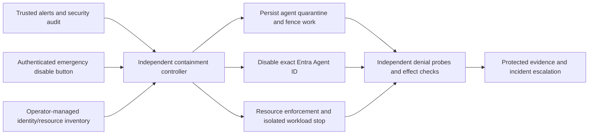

# Stage 7: Automatic containment of an individual agent

Status: **local implementation started**, 2026-10-20. The [first local foundation](validation/local-quarantine-results.md) adds durable quarantine transitions, a disable-only Graph adapter and an injectable dispatch gate. Hosted controller, alert delivery and resource containment remain unimplemented; no identity or Azure changes have been made.

[All stages](../README.md) · [Ordered implementation tasks](../../tasks/stage-7-agent-containment.md) · [Validation plan and evidence](validation/README.md)

## Required outcome

Every independently containable agent has its own Microsoft Entra Agent ID. A configured bad-activity alert or threshold automatically quarantines that agent and disables authentication for that exact identity. The manual emergency control is Disable on the individual identity in the Microsoft Entra admin center. Planned controller reconciliation must observe that disable and apply quarantine without depending on alert threshold evaluation. Prefer containment when a configured security threshold fires; do not wait for model self-assessment or human confirmation. Re-enablement always requires separate, explicit operator authorization after investigation.

The target is to block the affected agent from Foundry, Blob Storage, MCP and **every Azure resource reachable through any credential it can obtain**. Turning off new token issuance is one action, not proof that already issued tokens, established connections or direct managed-identity routes have stopped working. An uncovered resource or unknown result leaves containment incomplete and release blocked.

This extends [Stage 5 controls](../stage-5/stage-5-production-guardrails.md); it does not close that stage's existing release gates. Existing monitoring and Agents view are inputs to this work, not evidence that automatic response already exists.

## Current baseline and identity boundaries

The [Agent ID checkpoint](../../entra-agent-id.md) records Agent ID use for inference/MCP. Blob, control, skill and telemetry access still use workload identity, with legacy grants retained. Re-inventory the deployed release rather than assuming that checkpoint remains exhaustive.

| Identity | Purpose | Individual containment rule |
| --- | --- | --- |
| Agent ID (tenant + directory object ID, separately recorded application ID) | Agent-specific downstream authority | One per independently containable logical agent and environment; replicas of that logical agent share its quarantine generation. Verify the directory object type before disable. |
| Blueprint and blueprint principal | Agent creation/token-exchange infrastructure, potentially shared | Never disable these to contain one agent. Shared blueprint credentials are not an individual security boundary. |
| System/user-assigned workload managed identity | Azure workload credential; may authenticate the blueprint or access services directly | Inventory federation and direct grants separately. Do not disable a shared identity, remove its shared grants or detach it from other apps. Dedicated identity changes require a reviewed resource-specific procedure. |
| Pull identity, API/CLI caller, cleanup job, controller and human operator | Separate operational authorities | Do not confuse these with the targeted agent. The agent must not impersonate them or invoke their administrative privileges. |

If two independent agents can mint tokens as one another through shared compute, a shared managed identity or blueprint credentials, distinct Agent IDs alone provide no effective isolation. Prove the exchange boundary, or isolate their compute/federated credentials before onboarding. The affected runtime must not be able to change quarantine, provision a replacement identity or grant itself access.

## Proposed control flow

Deploy the controller outside the agent's process and administrative boundary. Use a durable inbox and idempotent incident key `(tenant, agent object ID, incident ID)`, with an agent quarantine generation to fence old leases, queued messages, retries and late completions. Quarantine commits before acknowledging the alert. Directory disable and resource enforcement then proceed independently so a Graph outage does not delay local fencing. A remote effect already accepted before quarantine may complete: track and reconcile it; do not erase its reservation or claim cancellation reversed it.

The controller reads a trusted allowlisted registry and verifies event origin, rule/version and tenant/agent binding. Never resolve a target from prompt text, tool output, display name alone or caller-supplied arbitrary resource IDs. Unknown bindings go to incident escalation; verified local agent work is fenced where safely identifiable. Do not disable unrelated identities to compensate for ambiguity.

## Detection policy (proposed dev defaults; approve and freeze before implementation)

| Signal | Initial configurable trigger | Attribution and action |
| --- | --- | --- |
| Verified forbidden effect, identity impersonation or attempted control-state tampering | One trusted security event | Quarantine the bound agent immediately; preserve effects and evidence for review. |
| Repeated denied cross-owner/tool/credential attempts | 3 distinct authenticated dispatch events in a rolling 60 seconds | Count by tenant + Agent ID, deduplicate event IDs, then quarantine. User-caused denials alone need a reviewed attribution rule to avoid targeting another agent. |
| Trusted monitor high-severity bad-activity alert | One firing of an explicitly enabled rule/version | Persist quarantine and disable the mapped Agent ID. Never derive identity from free-text alert descriptions. |
| Emergency disable button | One authorized, audited operator request | Same containment operation, no alert threshold and no agent approval. |

Store rule enablement, severities, windows, thresholds, provenance, maximum signal age/clock skew, mapping version and allowlist outside runtime write access. Validate configuration, test false positives, out-of-order and duplicate signals, and retain signed/versioned policy history. Expired or malformed events cannot clear quarantine; failed validation raises an operational alert. A trusted incident accepted before an age limit remains actionable after processing delay. Preserve the original detection time for SLO measurement.

## Resource enforcement matrix to prove

| Access path | Required containment work | Evidence needed before passing |
| --- | --- | --- |
| Foundry model inference / agent service / project and account APIs | Determine exact resource scope, Agent ID role, workload fallback, local/API keys, connections and effective network routes. Disable target issuance; remove only target-specific grants where appropriate; enforce an independent per-agent gate or isolated egress/workload boundary while permissions propagate. | Reuse pre-disable tokens from an independent probe and attempt fresh exchange, inference and every granted API; record denials/effects, not just Graph success. Verify in-flight/streamed requests. |
| Blob preferences, sessions, policy, state, audit and skills | Enumerate all containers and readers/writers, direct managed-identity grants, shared keys, SAS, delegation keys, ACLs and inherited/group access. Migrate agent authority or introduce a reviewed isolated/brokered boundary that blocks direct bypass. Preserve independent controller/audit/cleanup access. | Fresh and cached tokens, open connections and conditional reads/writes fail for the quarantined agent; test direct MI and keys/SAS if reachable, expiry and propagation. Check before/after synthetic records, counters and reservations. |
| Private MCP and tool services | Enforce tenant + Agent ID quarantine at the independent service boundary; deny cached tokens and new sessions, fence established sessions and queued tool work. | Cached MCP session/token, reconnect, replay and alternate route all denied; unrelated Agent ID remains authorized. |
| Other Azure services and management plane | Inventory Key Vault, ACR, Insights ingestion, ARM, queues, deployments and every other reachable API; mark each as reachable/denied with the actual credential and control. | One denial/effect probe per inventoried capability plus tests for unknown destinations, inherited grants and newly introduced resources. Inventory drift blocks release/onboarding. |

Do not assume RBAC removal, Conditional Access, Continuous Access Evaluation, a container stop or a network rule instantly invalidates a token. A stopped container is not proof that an exfiltrated token is unusable elsewhere. If external stale-token use cannot meet the bound at a shared service, redesign its access boundary (for example, an exclusive broker, dedicated resource or supported service-side enforcement); keep the gate open until measured. A broker is sufficient only when direct credentials/routes cannot bypass it.

Never rotate shared keys, revoke all account delegation keys, close shared endpoints or alter a shared blueprint/identity automatically as an individual response. Discover such dependencies as isolation blockers. Any wider emergency action needs a separately authorized incident procedure and explicit blast-radius evidence.

## Controller authority and failure behavior

Define exact Graph API/version, writable identity property/action, supported app-only permission, consent and object scope through investigation. Do not infer least privilege from the portal's administrator role or assign broad tenant-wide write authority as a shortcut. If the platform cannot constrain the desired write, document the limitation and select a reviewed constrained administrative service; an in-process allowlist alone does not reduce a stolen Graph token's platform authority.

Separate directory disable, scoped resource actions and read-only verification identities where practical. The controller may publish quarantine and append evidence, but cannot grant itself new access. The agent cannot edit alert rules, controller code, inbox, identity registry, quarantine, network controls or incident retention. Operator recovery authority is separate from automated disable authority. Test these negative permissions.

State progression: `active → quarantined → disabling → verifying → contained`; failures remain `quarantined / containment_failed`, with per-action status and reconciliation retries. Never report contained solely because an API accepted an asynchronous request. Use conditional writes, bounded retries with backoff/jitter, rate-limit handling, durable checkpoints and an independent watchdog. Duplicate incidents converge on disabled state without repeated destructive actions. New alerts cannot reset timers or authorize recovery.

On controller outage, independent dispatch/broker enforcement requires fresh controller-owned authorization leases and fails closed after the agreed lease bound. A separate watchdog stops/quarantines dedicated execution when heartbeat or evidence delivery fails. This must be external to untrusted agent code. If no independent fail-closed boundary exists, declare the outage scenario uncontained. Durable events replay after restart; no automatic re-enable or backlog execution follows recovery.

## Measurable proposed acceptance targets

These are **design targets, not measured guarantees**. Approve them before tests; do not silently loosen them after a failure. Existing Stage 5 2-second polling, 10-second runtime containment and 30-second run leases remain separate contracts.

- Record UTC and monotonic test timings for bad activity, alert firing/delivery, quarantine commit, last accepted dispatch/effect, directory request/confirmation, per-resource denial, escalation and recovery.
- From controller receipt/manual submission: persist quarantine within 5 seconds; within 10 seconds reject new/queued dispatch and fence active results across replicas. Zero newly authorized forbidden effects after the fence; reconcile pre-fence accepted effects separately.
- Submit exact-identity disable within 10 seconds. If not verified disabled within 60 seconds, raise containment-failure escalation while quarantine remains active and retries continue. API propagation failure is not a pass.
- Target independent service denial of **all** inventoried paths, including pre-issued/exfiltrated tokens, within 60 seconds of receipt. Prove this per service; an unsupported service blocks this gate and requires redesign or an explicitly approved revised policy before testing. RBAC propagation documentation does not establish this target is attainable.
- Measure detection separately: proposed alert-to-controller delivery at most 60 seconds; for windowed rules report window/evaluation/ingestion delay and total activity-to-denial time. Report worst case and p95 over at least 20 repeated drills; every safety case must pass its maximum, not only an average.
- Controller outage: independent authorization lease at most 10 seconds; after expiry no new dispatch; watchdog/escalation within 60 seconds. Prove direct stolen-token denial independently of the runtime lease.
- Targeted agent denial in 100% of specified probes; zero successful foreign-data effects, zero unrelated-agent interruption and zero lost audit/control accounting. Prove positive control for agent B before/during/after A's quarantine, including a shared-blueprint case.

## Recovery and scope

Use Entra ID → Agents → Agent identities → select the verified individual agent → Disable as the manual emergency control. Restrict directory access to authorized incident operators and retain the directory audit actor, exact object ID and incident reference. Implement controller reconciliation of portal disable with durable quarantine and visible per-action status; test its delay and outage behavior. A portal disable alone is not proof that application/resource quarantine happened. No custom administrative button is required for this first scope.

Recovery requires an incident review, identified cause, credential/grant review, reconciled unknown effects, healthy controller and current inventory. An explicitly authorized recovery action binds actor, incident, Agent ID, quarantine generation and reviewed configuration. Invalidate old caches/leases/sessions/approvals; do not resurrect queued work or reset budgets. While quarantine holds, re-enable only the exact approved identity and perform isolated canaries; release quarantine last. Partial failure restores/retains quarantine. Auto-clear alerts never authorize reset.

This stage includes design, implementation tasks, manual/automatic single-agent containment and adversarial QA. It excludes an SOC replacement, autonomous remediation/re-enablement, tenant-wide disable, blueprint-wide disable, destructive shared-resource emergency actions and retroactive reversal of accepted external effects. This plan does not itself authorize a live disable, new controller permissions or Azure deployment. Local implementation progress is recorded separately.

## Verified Microsoft sources and investigation limits

Reviewed 2026-10-20. Platform documentation supports a design direction; tenant-specific API permissions, licensing, delays and service behavior still require the investigation and hosted tests below.

- [Agent identity management](https://learn.microsoft.com/en-us/entra/agent-id/manage-agent-identities-organization): distinguishes individual, blueprint and tenant scopes. Select only the individual scope.
- [Disable agent identities](https://learn.microsoft.com/en-us/entra/agent-id/disable-agent-identities): documents individual portal disable and wider Conditional Access options. It does not establish immediate invalidation of all existing resource tokens.
- [Agent principals and applications](https://learn.microsoft.com/en-us/entra/agent-id/agent-service-principals): managed identities can be blueprint credentials; they are not the agent identity.
- [Graph Agent ID API overview](https://learn.microsoft.com/en-us/graph/api/resources/agentid-platform-overview?view=graph-rest-1.0): starting point for verifying the exact automated disable API and permissions. Do not assume a generic service-principal update supports every agent type.
- [Foundry agent identity concepts](https://learn.microsoft.com/en-us/azure/foundry/agents/concepts/agent-identity): distinct identity layers; verify applicability to this Container Apps-hosted runtime separately.
- [Azure RBAC troubleshooting](https://learn.microsoft.com/en-us/azure/role-based-access-control/troubleshooting): permission changes have propagation delays; group-based managed-identity changes can be cached much longer. Do not use these as a rapid kill switch.
- [Revoke Blob user delegation SAS](https://learn.microsoft.com/en-us/rest/api/storageservices/create-user-delegation-sas#revoke-a-user-delegation-sas): revocation/cache limitations and scope require separate analysis.
- [Access tokens](https://learn.microsoft.com/en-us/entra/identity-platform/access-tokens): resource validation and token lifetimes are distinct from issuance. Its generic token guidance explicitly has limits for Microsoft-owned APIs; measure these resources rather than assuming one lifetime.
- [Azure Monitor action groups](https://learn.microsoft.com/en-us/azure/azure-monitor/alerts/action-groups): alert action integration options. Verify authenticated delivery, retry behavior, regional availability and latency for the selected receiver.
